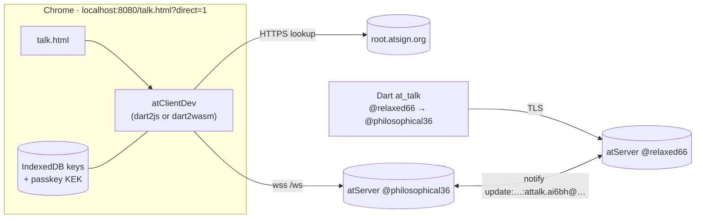

# Presenting the at_talk browser demo

Presenter's runbook for the [at_talk demo](at-talk-demo.md): pitch, pre-flight, run of show, recovery, Q&A. Time: ~10 min live + questions.

## The pitch (30 seconds)

> A browser tab can now hold an end-to-end encrypted atProtocol conversation with production atServers. No native app, no proxy, no server-side key custody. The same Dart client compiles to JavaScript and to WebAssembly, and the keys never leave the browser.

| Claim | Evidence |
|---|---|
| Browser on production atServers, no proxy | 2026-11-03, `?direct=1`, tab → Dart `at_talk` over `attalk.ai6bh` |
| Both compilers build | dart2js (live), dart2wasm (receive leg, headless Chrome, 2026-10-27) |
| Real crypto path | shared-key encrypt in the browser, decrypted by the CLI |
| Real delivery path | `notify` push, then the monitor on the peer |

## Architecture

| Path | Flag | Status |
|---|---|---|
| Direct `/ws`, found by the root's HTTPS lookup (D-15 production default) | `?direct=1` | Browser → CLI ran live 2026-11-03 |
| Via `at_secondary_proxy` (dev only) | default | Ran live 2026-10-27 on a docker VE |

## Pre-flight (do 30 min before)

| # | Check | Command / expectation |
|---|---|---|
| 1 | Page built and served | `packages/at_client_wasm/tool/build.sh`, serve `build/` on `localhost:8080` with `Cache-Control: no-store` |
| 2 | Keys | `~/.atsign/keys/@philosophical36_key.atKeys` (browser) and `@relaxed66_key.atKeys` (CLI), with the CLI's passphrase to hand |
| 3 | CLI | In packages/at_client_cli, in a real terminal: `dart run example/bin/at_talk.dart -a @relaxed66 -t @philosophical36 -k ~/.atsign/keys/@relaxed66_key.atKeys --never-sync -P <passphrase>`. Start it before the tab. |
| 4 | Browser | Chrome, one **visible** window, `http://localhost:8080/talk.html?direct=1`, **never** `127.0.0.1` (WebAuthn rejects an IP rpId) |
| 5 | Passkey | Touch ID / security key for this origin. The first open asks for the `.atKeys` file, and later opens need only the passkey |
| 6 | Dry run | Both directions once, before the audience arrives |

## Run of show

| Min | Step | Say | Do |
|---|---|---|---|
| 0:00 | Frame | The pitch above | Show the architecture slide |
| 1:00 | Setup | "Two production atSigns, one browser, one Dart CLI" | Show the terminal with the CLI waiting |
| 2:00 | Open | "Keys sit in IndexedDB, unlocked by a passkey" | Me `@philosophical36`, Peer `@relaxed66`, **Open**, passkey touch |
| 3:30 | Browser → CLI | "That text is encrypted to the peer's key in the browser" | Type a line; point at the CLI printing it |
| 5:00 | CLI → browser | "Delivery is a notify push to the tab's monitor" | Type in the CLI; the bubble appears in the tab |
| 6:30 | dart2wasm | "Same source, different compiler" | Reload with `&wasm=1`; the build badge reads `dart2wasm`; repeat. Only if the dry run passed |
| 9:30 | Close | Limits below | Show the Not done list |

Keep the tab visible and focused throughout. Chrome freezes background tabs, which drops the monitor connection.

**Direct-mode results:** ☑ browser → CLI · ☑ CLI → browser (both 2026-11-03, branch `st/wasm/at-talk-demo-trunk`) · ☐ dart2wasm

Until a box is ticked, say "implemented and unit-tested", **not** "demonstrated".

## If something breaks

| Symptom | Cause | Fix |
|---|---|---|
| The browser says `delivered`, but the CLI prints nothing | A build from before the namespace fix sends `attalk.ai6bh.attalk` | Rebuild, then hard reload |
| A send fails with `not delivered (status …)` | The atServer's raw notify status | `expired`: peer offline past the expiry; `errored`: read the atServer reply |
| CLI exits right after starting | stdin hit EOF (e.g. it was run via a non-interactive shell) | Run it in a real terminal |
| `SecurityError: effective domain … not a valid domain` | Loaded from `127.0.0.1` | Use `localhost` |
| Message from the CLI never arrives | Tab was backgrounded and the monitor reconnected | Keep it visible. Reconnect replay is fixed |
| `ArgumentError (storage)` on reopen | A failed open left a cached client | Fixed, so reload the page |
| A fix "didn't take" | Stale `at_client.js` | Serve with `no-store`, hard reload |

Fallback if live fails: play the recorded run (record one during the dry run) and walk the architecture slide.

## Likely questions

| Question | Answer |
|---|---|
| Where are the keys? | In the browser's IndexedDB, sealed under a passkey KEK, never sent to a server |
| Is there a proxy? | Not in direct mode. The tab looks the atServer up over HTTPS and connects to its `/ws` (D-15) |
| Does it work on Safari / Firefox? | The storage lab (E1–E7) ran on Chromium, WebKit, Firefox and real Safari. The talk demo itself ran on Chrome only |
| What if the tab reloads? | A new session replays from its creation time. The D-24 replay policy is `window(1h)` |
| dart2js or dart2wasm? | Both build. dart2wasm was exercised on the receive leg only |

## Say plainly (limits)

- Direct mode ran live both ways (browser ↔ CLI); dart2wasm in direct mode is not yet recorded.
- Passphrase-protected `.atKeys` are not parsed in the browser.
- The replay watermark is in memory, and the CLI shows replays too (`shouldShow` is a stub).

## References

| What | Where |
|---|---|
| Demo write-up and gotchas | [at-talk-demo.md](at-talk-demo.md) |
| Direct-path ruling D-15 | [decisions.md](decisions.md) |
| Roadmap | [roadmap.md](roadmap.md) |
| Directory HTTP lookup | at_server#2894, bead `at_client_sdk-0b4` |
