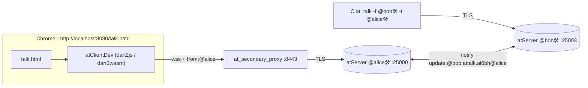

# at_talk in the browser — demo

**Status:** working end-to-end on one Mac (2026-10-27) · **Bead:** `at_client_sdk-5q6`

A Chrome tab (`web/talk.html` on the `at_client_wasm` dev harness) chats end-to-end encrypted with the C `at_talk` example. Both directions work, and both builds (dart2js, dart2wasm) receive.

## Results

| Leg | Build | Result | Evidence |
|---|---|---|---|
| browser → CLI | dart2js | PASS | the CLI decrypted "hi bob" |
| CLI → browser | dart2js | PASS (tab visible) | notify pushed, shared-key lookup, bubble shown |
| CLI → browser | dart2wasm | PASS | headless Chrome `--compiler dart2wasm` received "wasm hello" |
| reopen after a failed open | both | unit-tested | `session_test.dart` retry test |

## Running it

| Piece | How |
|---|---|
| atServers | `atsigncompany/virtualenv:dev_env` via docker compose, ports `127.0.0.1:64`, `25000-25039`; `extra_hosts: vip.ve.atsign.zone:127.0.0.1`. The image already carries renewed certs. |
| pkam keys | `supervisorctl start pkamLoad` inside the container (it is `autostart=false`) before any PKAM auth. |
| hosts | `/etc/hosts`: `127.0.0.1 vip.ve.atsign.zone` |
| proxy | `at_secondary_proxy` from `at_services`: `dart run bin/main.dart --proxy-url vip.ve.atsign.zone:8443 --root-url vip.ve.atsign.zone:64 --bind-port 8443 --cert-dir certs`, certs copied out of the container (`/atsign/secondary/base/certs`). |
| page | `tool/build.sh`, then serve `build/` on `127.0.0.1:8080` with `Cache-Control: no-store`. Open `http://localhost:8080/talk.html` (add `?wasm=1` for dart2wasm). |
| CLI | `at_talk` from `at_c/examples/desktop/at_talk` with the fixes in [at_c#728](https://github.com/atsign-foundation/at_c/issues/728) and `ROOT_HOST` set to `vip.ve.atsign.zone`; keys in `$HOME/.atsign/keys/`. |

## Gotchas found

| Symptom | Cause | Fix |
|---|---|---|
| `SecurityError: The effective domain of the document is not a valid domain` | WebAuthn takes the rpId from `location.hostname`, and an IP is not a valid one | load the page from `localhost`, not `127.0.0.1` |
| `AT0014 Unexpected response found` on open | the proxy closes the socket and the client reports the raw response, which hides the proxy's reason | read the proxy log |
| `StateError: There is no atDirectory lookup on the web` | `NotificationServiceImpl` defaulted to the atDirectory finder | `secondaryAddressFinder` threaded through `remoteOnlyClient` / `portalSession` / `ephemeralSession`; the dev opener passes `ProxySecondaryAddressFinder` |
| `ArgumentError (storage)` on a second open | a failed open left the client in the `AtClientImpl` cache | `remoteOnlyClient` stops the client when `NotificationServiceImpl.create` throws |
| a fix "didn't take" | a stale cached `at_client.js` | a `no-store` dev server |
| CLI → browser message lost | Chrome froze the background tab (no heartbeats for 7 min). On refocus the monitor reconnected with no watermark, so nothing replayed. | keep the tab visible; replay fixed in `at_client` (below) |
| C CLI aborts at exit, losing stdout | `free()` of `optarg` | at_c#728 |
| C CLI authenticates against `root.atsign.org` | `ROOT_HOST` unused; the monitor passes `NULL` options | at_c#728 |

## Replay after reconnect (`at_client_sdk-336`)

- **Bug:** `RemoteWriteThroughKeyStore.exists` threw `UnsupportedError`. The watermark migration calls `exists`, so a remote-only client's monitor reconnected with no `since`, and anything sent while it was down was lost.
- **Fix:** `exists` is `get`-or-`KeyNotFoundException` for both local (in-memory) and remote keys. The monitor now sends `monitor:selfNotifications:<epochMillis>`; this was seen live.
- **Limit:** the watermark is a `local:` key, held in memory for the session. A page reload starts from the new session's creation time; the D-24 replay policy (`window(1h)`) covers that.

## Not done

- A proxy-free client: atDirectory HTTP lookup via at_server#2894 plus the atServer's `wss://…/ws` (`at_client_sdk-0b4`, waiting on deployment). The demo ran through the dev proxy path (`at_secondary_proxy`); the direct path has never run live.
- A manual click-through of the dart2wasm build and a same-tab reopen in a real Chrome window. Both paths are covered headlessly and in unit tests.
