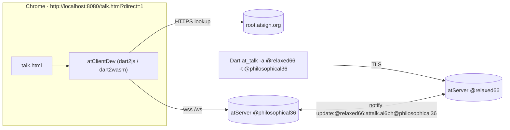

# at_talk in the browser — demo

**Status:** direct mode working against production atSigns (2026-11-03, trunk port) · **Bead:** `at_client_sdk-5q6`

A Chrome tab (`web/talk.html` on the `at_client_wasm` dev harness) chats end-to-end encrypted with the Dart `at_talk` CLI (`packages/at_client_cli/example/bin/at_talk.dart`). In direct mode (`?direct=1`), the tab finds each atSign's atServer through the root's HTTPS lookup and connects to it over `wss://…/ws`. There is no proxy, no docker VE, and no hand-entered address.

## Results

| Date | Leg | Mode / build | Result | Evidence |
|---|---|---|---|---|
| 2026-11-03 | browser → CLI | direct, dart2js | PASS | the Dart CLI printed the browser's message |
| 2026-11-03 | CLI → browser | direct, dart2js | PASS | the CLI's message appeared as a bubble in the tab, in a two-way chat |
| 2026-10-27 | browser → C CLI | proxy, dart2js | PASS | the C CLI decrypted "hi bob" (docker VE) |
| 2026-10-27 | C CLI → browser | proxy, dart2js and dart2wasm | PASS | bubble shown; headless Chrome `--compiler dart2wasm` received "wasm hello" |
| — | reopen after a failed open | both | unit-tested | `session_test.dart` retry test |

## Running it (direct mode, production atSigns)

Start the CLI first, then open the tab.

| Piece | How |
|---|---|
| page | `packages/at_client_wasm/tool/build.sh`, then serve `build/` on `localhost:8080` with `Cache-Control: no-store` (`tool/serve.dart`). Open `http://localhost:8080/talk.html?direct=1` (add `&wasm=1` for dart2wasm, `&root=host:port` for another root). |
| browser | Me `@philosophical36`, Peer `@relaxed66`. On the first open, choose `@philosophical36_key.atKeys` when asked. It is sealed under a new passkey on the device, and later opens need only the passkey. |
| CLI | In packages/at_client_cli, in your own terminal (it exits on stdin EOF): `dart run example/bin/at_talk.dart -a @relaxed66 -t @philosophical36 -k ~/.atsign/keys/@relaxed66_key.atKeys --never-sync -P <passphrase>` |

`--never-sync` only turns sync off, and notifications don't need sync. The monitor and the nskey decrypt fetch directly from the atServer.

## What works, what is stubbed

| Area | State |
|---|---|
| Direct mode: root HTTPS lookup, `wss /ws`, PKAM | works live |
| Encrypted notify both ways, wire key `attalk.ai6bh` | works live, both ways |
| `.atKeys` upload sealed under a passkey; no PRF → held in memory | works, unit-tested |
| A send that isn't delivered names the raw status (`expired`, `errored`, …) | works, unit-tested |
| Proxy mode (`at_secondary_proxy`) | kept, last run live 2026-10-27 |
| Passphrase-protected `.atKeys` in the browser | not parsed |
| Mode E `ephemeral_session`, `WriteThroughSyncService` | dropped from the trunk port |
| Three tests on the pre-trunk API | dropped from the trunk port |
| `peekNewlyAvailable` | returns empty |
| Replay watermark | in memory only; a reload replays from the new session's creation time |
| CLI `shouldShow` | stub: shows everything, including replays |

## Gotchas found

| Symptom | Cause | Fix |
|---|---|---|
| The browser says `delivered`, but the CLI prints nothing | at_client folds a namespace-aware key into the app namespace (`attalk.ai6bh` → `attalk.ai6bh.attalk`), and the CLI's `attalk\.ai6bh@` regex skips it silently | `AtClientDevSession.notify` sends with `namespaceAware = false` |
| A send says only `undelivered` | at_client maps `expired`, `errored` and `error:` to undelivered with no exception | the session queries `notify:status` and throws it |
| `-v` shows no receive lines on the CLI | `AtSignLogger` fixes its level when built, inside `CLIBase` | raise `atClient.notificationService.logger.level` for a one-off trace |
| `SecurityError: The effective domain of the document is not a valid domain` | WebAuthn takes the rpId from `location.hostname`, and an IP is not a valid one | load the page from `localhost`, not `127.0.0.1` |
| `AT0014 Unexpected response found` on open (proxy mode) | the proxy closes the socket, and the client reports the raw response | read the proxy log |
| `ArgumentError (storage)` on a second open | a failed open left the client in the `AtClientImpl` cache | `remoteOnlyClient` stops the client when `NotificationServiceImpl.create` throws |
| a fix "didn't take" | a stale cached `at_client.js` | a `no-store` dev server, and a hard reload |
| CLI → browser message lost | Chrome froze the background tab, and the monitor reconnected | keep the tab visible; reconnect replay is fixed (below) |

## Replay after reconnect (`at_client_sdk-336`)

- **Bug:** `RemoteWriteThroughKeyStore.exists` threw `UnsupportedError`, so a remote-only client's monitor reconnected with no `since`. Anything sent while it was down was lost.
- **Fix:** `exists` is `get`-or-`KeyNotFoundException`. The monitor sends `monitor:selfNotifications:<epochMillis>`.
- **Limit:** the watermark is a `local:` key held in memory for the session. The D-24 replay policy (`window(1h)`) covers a reload.

## Not done

- A dart2wasm click-through in direct mode.
- Passphrase-protected `.atKeys` in the browser.
