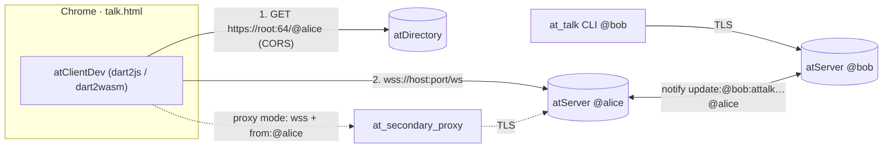

# at_talk in the browser — demo

**Status:** two-way chat working through the dev proxy (2026-10-27) and direct on production atSigns, both ways (2026-11-03) · **Bead:** `at_client_sdk-5q6` · **Code:** the session opener, both transports (`devTransport`) and the peer-key fix are in [#2430](https://github.com/atsign-foundation/at_client_sdk/pull/2430) (tracker [#2437](https://github.com/atsign-foundation/at_client_sdk/issues/2437)). The chat page `web/talk.html` and the Dart `at_talk` CLI example (`packages/at_client_cli/example/bin/at_talk.dart`) are on `st/wasm/at-talk-demo-2430`, stacked on #2430.

A Chrome tab (`web/talk.html` on the `at_client_wasm` dev harness) chats end-to-end encrypted with an `at_talk` CLI. Two transports, chosen once per page load:

| Mode | How the browser reaches an atServer | Role |
|---|---|---|
| **direct** (`?direct=1`) | HTTPS lookup on the atDirectory (`GET https://<root>:64/@atSign`), then `wss://<host>:<port>/ws` on that atSign's own atServer | the target path; works in production ([`decisions.md`](decisions.md) OQ-7 production state; CORS allowlist is [at_server#2921](https://github.com/atsign-foundation/at_server/issues/2921)) |
| **proxy** (default) | every connection to `at_secondary_proxy`, which forwards over TLS | dev-only fallback, for a local virtualenv |

## Results

| Leg | Mode | Build | Result | Evidence |
|---|---|---|---|---|
| browser → CLI | direct | dart2js | PASS (2026-11-03) | two production atSigns; the Dart `at_talk` CLI printed the browser's message |
| CLI → browser | direct | dart2js | PASS (2026-11-03) | the CLI's message appeared as a bubble in the tab, in a two-way chat |
| browser → CLI | proxy | dart2js | PASS | the C CLI decrypted "hi bob" |
| CLI → browser | proxy | dart2js | PASS (tab visible) | notify pushed, shared-key lookup, bubble shown |
| CLI → browser | proxy | dart2wasm | PASS | headless Chrome `--compiler dart2wasm` received "wasm hello" |
| reopen after a failed open | both | both | unit-tested | `session_test.dart` retry test |

## Running it

**Direct (production atSigns)**

Start the CLI first, then open the tab.

| Piece | How |
|---|---|
| page | `packages/at_client_wasm/tool/build.sh`, then serve `build/` on `localhost:8080` with `Cache-Control: no-store` (`tool/serve.dart`). Open `http://localhost:8080/talk.html?direct=1` (add `&wasm=1` for dart2wasm, `&root=host:port` for another root). |
| browser | Enter your own atSign as Me and the CLI's atSign as Peer. On the first open, choose your `.atKeys` file when asked; it is sealed under a new passkey on the device, and later opens need only the passkey. |
| CLI | In packages/at_client_cli, in your own terminal (it exits on stdin EOF): `dart run example/bin/at_talk.dart -a <cli atSign> -t <browser atSign> -k <path to cli .atKeys> --never-sync` |

`--never-sync` only turns sync off; notifications don't need sync. Both sides use the wire key `attalk.ai6bh`.

The proxy environment below is dev-only.

**Proxy (local virtualenv, dev-only)**

| Piece | How |
|---|---|
| atServers | `atsigncompany/virtualenv:dev_env` via docker compose, ports `127.0.0.1:64`, `25000-25039`; `extra_hosts: vip.ve.atsign.zone:127.0.0.1`. The image already carries renewed certs. |
| pkam keys | `supervisorctl start pkamLoad` inside the container (it is `autostart=false`) before any PKAM auth. |
| hosts | `/etc/hosts`: `127.0.0.1 vip.ve.atsign.zone` |
| proxy | `at_secondary_proxy` from `at_services`: `dart run bin/main.dart --proxy-url vip.ve.atsign.zone:8443 --root-url vip.ve.atsign.zone:64 --bind-port 8443 --cert-dir certs`, certs copied out of the container (`/atsign/secondary/base/certs`). |
| page | `talk.html`, built with `tool/build.sh` and served from `localhost` with `Cache-Control: no-store`, without `?direct=1` |
| CLI | C `at_talk` with at_c#728 and `ROOT_HOST=vip.ve.atsign.zone`; keys in `$HOME/.atsign/keys/` |

The VE root needs a trunk rebuild (at_server#2894) before `?direct=1&root=` can target it, so the virtualenv still runs through the proxy.

## What works, what is stubbed

| Area | State |
|---|---|
| Direct mode: root HTTPS lookup, `wss /ws`, PKAM | works live |
| Encrypted notify both ways | works live |
| `.atKeys` upload sealed under a passkey; no PRF → held in memory | works, unit-tested |
| A send that isn't delivered names the raw status (`expired`, `errored`, …) | works, unit-tested |
| Proxy mode (`at_secondary_proxy`) | kept, last run live 2026-10-27 |
| Passphrase-protected `.atKeys` in the browser | not parsed |
| `peekNewlyAvailable` | returns empty |
| Replay watermark | in memory only; a reload replays from the new session's creation time |
| CLI `shouldShow` | stub: shows everything, including replays |

## Gotchas found

| Symptom | Cause | Fix |
|---|---|---|
| The browser says `delivered`, but the CLI prints nothing | at_client folds a namespace-aware key into the app namespace (`attalk.<id>` → `attalk.<id>.attalk`), and the CLI's key regex skips it silently | the dev session sends with `namespaceAware = false` |
| A send says only `undelivered` | at_client maps `expired`, `errored` and `error:` to undelivered with no exception | the dev session queries `notify:status` and throws it |
| `-v` shows no receive lines on the Dart CLI | `AtSignLogger` fixes its level when built, inside `CLIBase` | raise `atClient.notificationService.logger.level` for a one-off trace |
| `SecurityError: The effective domain of the document is not a valid domain` | WebAuthn takes the rpId from `location.hostname`, and an IP is not a valid one | load the page from `localhost`, not `127.0.0.1` |
| `AT0009` on the peer-key lookup (direct) | a fixed address sent the peer's key-copy lookup to the user's own atServer | the peer-key lookup passes no finder, so the root lookup applies |
| `AT0014 Unexpected response found` on open (proxy) | the proxy closes the socket and the client reports the raw response, which hides the proxy's reason | read the proxy log |
| `StateError: There is no atDirectory lookup on the web` | `NotificationServiceImpl` defaulted to the atDirectory finder | `secondaryAddressFinder` threaded through the session openers |
| `ArgumentError (storage)` on a second open | a failed open left the client in the `AtClientImpl` cache | `noStorageClient` stops the client when `NotificationServiceImpl.create` throws |
| a fix "didn't take" | a stale cached `at_client.js` | a `no-store` dev server |
| CLI → browser message lost | Chrome froze the background tab (no heartbeats for 7 min); on refocus the monitor reconnected with no watermark | keep the tab visible; replay fixed in `at_client` (below) |
| C CLI aborts at exit, losing stdout | `free()` of `optarg` | at_c#728 |
| C CLI authenticates against `root.atsign.org` | `ROOT_HOST` unused; the monitor passes `NULL` options | at_c#728 |

## Replay after reconnect (`at_client_sdk-336`)

- **Bug:** `RemoteWriteThroughKeyStore.exists` threw `UnsupportedError`. The watermark migration calls `exists`, so a remote-only client's monitor reconnected with no `since`, and anything sent while it was down was lost.
- **Fix (in #2430):** `exists` is `get`-or-`KeyNotFoundException`. The monitor now sends `monitor:selfNotifications:<epochMillis>`; this was seen live.
- **Limit:** the watermark is a `local:` key, held in memory for the session. A page reload starts from the new session's creation time. The browser default replay is now *connect* with a reconnect supervisor ([`decisions.md`](decisions.md) D-24, amended 2026-11-02; [#2439](https://github.com/atsign-foundation/at_client_sdk/issues/2439)).

## Not done

- dart2wasm in direct mode.
- Passphrase-protected `.atKeys` in the browser.
- `talk.html` and the Dart `at_talk` example in a PR.
- A manual click-through of the dart2wasm build and a same-tab reopen in a real Chrome window. Both paths are covered headlessly and in unit tests.
- Browser-tagged tests (`test/js`, `test/web`) in CI ([#2431](https://github.com/atsign-foundation/at_client_sdk/pull/2431)).
