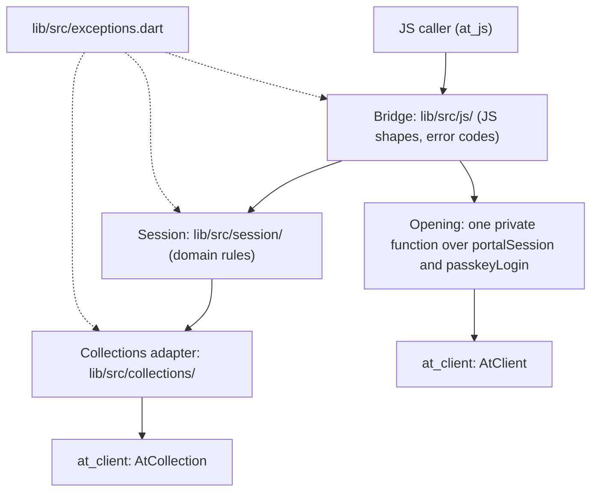

# Proposed layering of `at_client_web` (D-38..D-44)

**Status: Proposed (D-38..D-44).** No proposed layer is built on trunk. The decisions
themselves are the rows in [`docs/architecture/decisions.md`](../../architecture/decisions.md);
this page gives the layering and reasoning behind them. The layer allocations this page describes for the closed state, regex compilation, namespace
folding, id lowercasing and error mapping are re-proposed by the implementing PRs, which carry their tests,
and are the subject of D-42, D-43 and D-44. Trunk's `at_client_web` has `portalSession`, `passkeyLogin` and
`lib/src/collections/js_collections_adapter.dart`, and no `lib/src/js/` bridge yet;
[`js-api.md`](js-api.md) section 4 says where the facade lives. The "Today" names and
columns below are those of the bridge implementation that follows these decisions (#2537),
not yet on trunk, except these, which are on trunk too: `portalSession`, `passkeyLogin`, the five exceptions the Exceptions
row lists, `JsCollectionsAdapter`, `JsItem`, `JsItemAddress`, `JsListing`,
`JsWhereClause`, `JsEvent`, `JsUnreadable`, the file `js_collections_adapter.dart`, and `tool/build.sh`. The names below are the proposed ones; every trunk type name and path stays, except `CollectionErrorCodes`, and except the five exception classes that moved into `lib/src/exceptions.dart` (`JsCollectionsError` is no longer declared in `js_collections_adapter.dart`), with `JsCollectionsError` and `JsUnreadable` changing shape to carry `CollectionFailure kind`.

JS values enter the bridge only at its top layer; below the bridge the session and adapter
layers take typed Dart. Existing platform helpers that need browser
APIs (the passkey, storage and setup helpers under `lib/src/keys/` and `lib/src/session/`) keep their own
`dart:js_interop` use; no decision here moves them behind the bridge's opening function.



| Layer | Where | Holds | Does not hold |
|---|---|---|---|
| Bridge | `lib/src/js/` (`bridge.dart`, `error_codes.dart`) | The only file in the bridge that touches `dart:js_interop`. `BridgeEntry`, `BridgeSession`, `BridgeCollection`. Shape checks (plain object, own property, string, function, array, finite number, depth), the converters `_toDart`, `_toJs`, `_toRejection`. | Closed-state checks, regex compilation, namespace folding, id lowercasing, key parsing, any rule about what an atSign may do. |
| Session | `lib/src/session/` (`at_client_session.dart`) | The `Session` interface and `AtClientSession`: the closed state, the namespace folded once in the constructor, the subscribe regex compiled once, incoming senders verified, the `__manage` grant, one decision per enrollment id at a time, one shared teardown that awaits the stop the opening function recorded. `SessionBoundCollection`, `ReceivedNotification`, `JsEnrollment`. | Any `dart:js_interop` type in the session interface or its domain rules (platform helpers under `lib/src/session/web_*.dart` keep their own), any error code. |
| Opening | `lib/src/js/bridge.dart` (one private function); `portalSession`, `passkeyLogin` and `PasskeySession` stay in `lib/src/session/` and `at_client` | The private function opens either kind of session, keys or passkey, validates its options before any side effect, and returns the `Session` whose `close()` awaits the stop it recorded. `portalSession`, `passkeyLogin`, `onboardNewAtSign` and `PasskeySession` keep their names and shapes. | A public opener interface, a new return type, or a second teardown rule. |
| Collections adapter | `lib/src/collections/` | The collections adapter over one `AtCollection`: the per-(id, owner) write queue, the id lowercased once, the type check on update, unreadable records listed instead of failing the call, a typed exception. Its names stay as they are on trunk until the collections interface is typed (see D-45, withdrawn, in the Reasoning). | Codes and message text. |
| Exceptions | `lib/src/exceptions.dart` | Every exception the package declares, each to extend `AtException`: `PortalSessionOfflineException`, `UnsupportedKeyMaterialException`, `JsCollectionsError`, `SetupLockTimeoutException` and `IndexedDbException`, all on trunk today, move into this one file. | Code mapping, which stays in the bridge. |
| Contract manifest | release asset `bridge-manifest.json` | A `schemaVersion`, every exported method and every error code, generated from the Dart constants and identical for both compile targets. at_js downloads it with the bundle, checks its sha256 against `bridge.ref`, and fails when its TypeScript types or code list disagree. | Anything written by hand. |
| Build target | `tool/build.sh` | Today `tool/build.sh` takes no target flag and builds `at_client.js` and `at_client.wasm` from `web/at_client_web_entry.dart`, as on trunk. The bridge bundle, D-38's `--target` (`dart2js` by default; `dart2wasm` strict, with no silent fallback; an unknown target exits 1) and the release target are implemented by the release PR; a release target is not part of D-38 (see its Reasoning). | A target chosen by an entry name passed to `tool/build.sh`. |

## Opening a session (D-40)

One private function in the bridge opens either kind of session. It calls `portalSession` for
keys and `passkeyLogin` for a passkey, and hands the `AtClientSession` the stop that
releases it: `AtClient.stop()` for a keys session, `PasskeySession.stop()` for a passkey
session, which closes the passkey's vault once the client has stopped (D-30). The session's
`close()` awaits that recorded stop. Nothing is renamed and no public type is added.

`BridgeEntry.create` builds `PasskeySessionOptions` when the call asks for passkey sign-in
(`passkey: true` with `rpId` and `rpName`) and `KeysSessionOptions` otherwise. The keys arm
takes a `SessionTransport`, by default `keysTransport(options)` (`sessionTransport` over the
options' root); the passkey arm takes the login, by default `browserPasskeyOpener`, which
builds the `SessionTransportOptions` for the options' root and calls `passkeyLogin`.
`openJsSession` lets a test pass that transport and that login to the same private
function, so it drives the real arms over fakes; no barrel exports it.

```dart
// private to lib/src/js/bridge.dart
Future<Session> _openSession(SessionOptions options,
    {SessionTransport? keysTransport, OpenPasskeySession? passkeyOpen});
```

`close()` rules:

- A second call returns the same future and throws no new error.
- A close can only come after the open has settled, and then stops what was opened.
  `AtClientSession` is constructed only after `portalSession`/`passkeyLogin` resolves, so no
  caller, Dart or JS, holds a session while it is opening, and nobody can close one then.
- The longest it waits is D-30's. The passkey vault closes once the client has stopped, or
  after 10 seconds plus `AtServerAtKeysIo.lockWaitBound` (75 seconds by default) from when
  the client's stop begins, and `close()` also awaits the client's own `stop()`. D-40 adds no
  bound of its own.

A failure after the open has returned stops the opened session before it is rethrown, so a
passkey's vault is never left open. Validation runs first, in a fixed order, before any side
effect, and rejects with an argument error without echoing a value.

## Reasoning

These decisions come from a design self-review of #2537, recorded in the first commit of this branch
([`a0fd351bd`](https://github.com/atsign-foundation/at_client_sdk/commit/a0fd351bd9d501aad2f2acd96928806cea4aaf56)) and
carried through #2601. The code owner's review of this PR on 2026-11-24 (#2602) changed D-38 and D-40 and withdrew D-45, and each
block below records what was considered and rejected. Each block gives the problem, the alternatives that were
actually on the table, the argument that settled it, and what would reopen it. The "Would reopen if" lines were
written for this PR; the review notes didn't record them.

### D-40 — one way to open a session

**Problem.** Trunk has two opening entry points with different shapes: `portalSession` returns an `AtClient`,
`passkeyLogin` returns a `PasskeySession` with its own stop ([D-40](../../architecture/decisions.md)). A passkey
opener added to the bridge would be a second opening path, and nothing in the bridge waits for the passkey vault to
be released.

**Options considered.**
- (a) Keep two opening paths in the bridge: rejected because the bridge would carry two teardown rules.
- (b) A public `SessionOpener` family, with `KeysSessionOpener` and `PasskeySessionOpener` returning an
  `OpenedSession` and renaming the pair: the original proposal of this PR, considered and rejected by the code owner
  in review on 2026-11-24. His reason: on D-30 he chose a wrapper over changing working code ("I want to minimize
  changes to existing proven machinery"); `PasskeySession` already holds the client and its stop and closes the
  vault cleanly; and `docs/sdk-shape.md` and `test/export_surface_test.dart` name `onboardNewAtSign` and
  `passkeyLogin`, so a rename changes proven entry points for the bridge's sake.
- (c) One private function in the bridge that opens either kind of session and records its stop (chosen).

**Decision and why.** One private function opens either kind of session and `close()` awaits its stop. The deciding
argument is the same as for the rejected family, teardown in one place, without touching proven machinery:
`portalSession`, `passkeyLogin`, `onboardNewAtSign` and `PasskeySession` keep their names and shapes, and the
public surface does not grow. `close()` is idempotent, waits for an open in progress, and waits no longer than
D-30's bound (see [Opening a session](#opening-a-session-d-40)).

**Would reopen if.** A caller outside the bridge needs to open a session by either route through one public type,
or a session's teardown can't be expressed as one awaitable stop.

### D-41 — one exceptions file

**Problem.** The package declares five exceptions across four files, and two of them do not extend `AtException`:
`PortalSessionOfflineException` and `UnsupportedKeyMaterialException` are plain `Exception` classes
([`portal_session.dart`](../../../packages/at_client_web/lib/src/session/portal_session.dart)). A caller catching
`AtException` therefore misses them, and a layer has to import another layer just to name its error class. The
[invariants](../../architecture/invariants.md) require an exception raised to a caller to extend `AtException` (A22).

**Options considered.**
- Keep the spread: rejected because two errors stay outside the catch-all and the layers stay coupled by imports.
- Move everything into one file and reuse at_commons' `StoppedException` for the closed session: the original choice
  in [`a0fd351bd`](https://github.com/atsign-foundation/at_client_sdk/commit/a0fd351bd9d501aad2f2acd96928806cea4aaf56),
  taken so that at_commons would not change for a name.
  [`31384cb89`](https://github.com/atsign-foundation/at_client_sdk/commit/31384cb89dae7b0477ff238273525123dbc533ab)
  recorded that the choice needs A22 amended, because
  [`StoppedException`](../../../packages/at_commons/lib/src/exception/stopped_exception.dart) is deliberately not an
  `AtException`.
  [`879e992d8`](https://github.com/atsign-foundation/at_client_sdk/commit/879e992d85fc6c9b7d1f28e3bbc2e90fd54337e9)
  then scoped the decision to the five trunk exceptions: the closed-session type exists only in #2537, so that choice
  and the amendment are left to that PR. If at_commons later gains an `AtException`-based closed-session type, that
  substitution becomes cheap.
- Move the five trunk exceptions into one file and extend `AtException` (chosen). The closed-session type is left to
  the implementing PR, where the #2537-only names live.

**Decision and why.** Domain errors, not JS-specific; follow the existing Dart convention; the layers stop importing
each other for an error class. The cost is a visible change for callers: the two plain `Exception` classes become
`AtException` subclasses, so a catch of `AtException` will begin to see them. The barrel exports must keep working,
and the implementing PR and its release notes must say so.

**Would reopen if.** A caller turns out to depend on `PortalSessionOfflineException` or
`UnsupportedKeyMaterialException` not being caught as `AtException`.

### D-45 — withdrawn

D-45 proposed one naming pattern and renames of trunk names: the opening entry points, the `Js`-prefixed
collections types and `PortalSessionOfflineException`. After the code owner's review on 2026-11-24 the opening
renames went into D-40's rejected alternative. The collections renames wait until the collections interface is
typed: the types are still `Map<String, Object?>`, `op` is a `String` and `watch` is callbacks, so dropping `Js`
would make an untyped surface read as typed and sit beside at_client's `CItem`, `CEvent` and
`CollectionOpException`. What remained, a rule for new names plus one rename, did not need a decision row, so D-45
is withdrawn and its id is retired, not reused. `PortalSessionOfflineException` keeps its name.

**Would reopen if.** The collections interface is typed.

### D-39 — a machine-readable contract

**Problem.** The bridge contract is described twice by hand: the code tables in [`js-api.md`](js-api.md) and the code
set in at_js's `error.ts`. Nothing compares either with the bundle, so a code or method can change in one place only
([D-39](../../architecture/decisions.md)).

**Options considered.**
- Keep the hand-kept lists: this is the drift the decision exists to remove.
- Hand-write a manifest: rejected because it would be a third hand-kept list beside [`js-api.md`](js-api.md) and
  at_js's `error.ts`, and would drift the same way.
- Generate the manifest from the Dart constants and ship it with the bundle (chosen).

**Decision and why.** Each release publishes `bridge-manifest.json` with a `schemaVersion`, every exported method and
every error code, identical for both compile targets. at_js downloads it with the bundle, checks its sha256 against
`bridge.ref`, and fails when its TypeScript types or code list disagree. Bridge and at_js types are both hand-written
and nothing checked them against each other; the manifest gives a consumer a machine-readable contract to pin
against.

**Cost.** The release now publishes a manifest and its checksum; additive changes keep `schemaVersion` 1, while a
rename or removal is a bridge-contract major. at_js has to adopt it, which is sequenced with the implementation, not
with this docs PR.

**Would reopen if.** at_js stops being the consumer, or the Dart constants stop being the single source for the
surface.

**Likely follow-up.** at_js generates its error codes and types from the manifest rather than checking a
hand-written list against it (raised in the code owner's review of 2026-11-24).

### D-38 — the compile target

**Problem.** The trunk build script takes no argument: it always runs both compilers, warns and exits 0 when the
dart2wasm build fails unless `WASM_REQUIRED=1`, and writes `at_client.js`. On trunk no workflow publishes the bridge. The target is
therefore implicit in whatever the script last ran, and a failed wasm build can leave a dart2js-only artifact ([D-38](../../architecture/decisions.md)).

**Options considered.**
- Keep the dual-build script: rejected because the target stays implicit and a wasm failure can pass silently.
- Keep dart2js as the primary target: D-38 does not reopen this. It keeps `dart2js` as the default, which is the
  position of [wasm D-7](decisions.md), and D-7 already keeps `dart2wasm` available "at zero cost". The measured
  evidence favoured dart2js: one 77 KB file (24.5 KB gzipped) against dart2wasm's four files at about 25 KB gzipped, and
  Sass ships dart2js ([js-api.md](js-api.md) section 2). D-38 decides how a wasm build is made, not
  which target is primary.
- A release workflow that takes the target as a `workflow_dispatch` input and tags a wasm release distinctly:
  considered and deferred, in the code owner's review of 2026-11-24, until OQ-16 (which target is primary) has
  product sign-off. Until then a bridge release, if any, is dart2js only and dispatchable from trunk only
  (`if: github.ref == 'refs/heads/trunk'`).
- A `--target` flag with `dart2js` as the default (chosen).

**Decision and why.** `tool/build.sh` takes `--target dart2js|dart2wasm`; `dart2js` is the default, `dart2wasm` is
strict with no silent fallback, and an unknown target exits 1. The deciding argument is that the entry already
compiles under both compilers (`test/web/compile_test.dart`), so the cost is in the build script, not in the bridge.

**Cost.** Two targets to keep building. No release workflow is part of this decision.

**Would reopen if.** The bridge stops being target-agnostic, or the wasm line is dropped. A wasm release is a
separate decision, taken once OQ-16 has product sign-off.

### D-42 — one owning layer per check

**Problem.** Four checks must hold on every path through the bridge, session and collections layers: that a
session is open, that the subscribe regex compiles, that the namespace is folded, and that the item id is
folded ([D-42](../../architecture/decisions.md)). Each is a rule a caller must not get past, and a layer that
repeats the check it meets carries a second copy of it.

**Options considered.**
- Each layer repeating the check it meets: the closed check in `BridgeCollection` and again in the session, the
  subscribe regex compiled in the bridge and in the session, the namespace folded in the bridge, the session
  constructor, `qualifiedCollectionName` and `_atKey`, and the id lowercased in the adapter and in the bridge.
  Rejected because a copy can drift from its twin.
- One owning layer per check (chosen): the closed state is `AtClientSession._open`, which
  `SessionBoundCollection` calls and the bridge does not repeat; the subscribe regex is compiled once, in
  `AtClientSession.subscribe`; the namespace is folded by `foldNamespace`
  (`lib/src/session/session_namespace.dart`) and nowhere else; the item id is folded by `foldItemId`
  (`lib/src/exceptions.dart`), which the exceptions and the adapter's item lock take their ids through. The
  bridge checks JS shapes only.

**Decision and why.** The session owns all four checks. It is the layer a caller of the session meets without
the bridge, so a check there cannot be bypassed.
[`at_client_session.dart`](../../../packages/at_client_web/lib/src/session/at_client_session.dart) holds the
closed check and the one regex compilation, and the two folds sit in the files the row names. The contract
scenarios the row names pin it: `a closed session refuses each call with SessionClosedException` and
`subscribe with invalid regex rejects naming regex`.

**Would reopen if.** A check needs a fact only the bridge has, or a second caller of the session needs the same
check made somewhere else.

### D-43 — only the bridge words JS text and picks codes

**Problem.** An error crossing into JS needs a code and a message, and three layers throw: the bridge, the
session and the collections adapter ([D-43](../../architecture/decisions.md)). If each thrower carries its own
code and finished text, the codes have more than one owner.

**Options considered.**
- Each exception carrying its own code and message, as `CollectionErrorCodes` and `JsCollectionsError` did for
  the adapter: rejected because it gives the adapter a JS-facing vocabulary, so the codes have two owners and
  the D-39 manifest no single source, and an exception's text choosing a code or reaching JS would let a
  message from inside `at_client` change what a caller sees.
- Typed exceptions carrying a kind and structured fields, with one mapping (chosen): `errorCodeOf` and
  `atErrorMessage` in [`error_codes.dart`](../../../packages/at_client_web/lib/src/js/error_codes.dart) are pure
  functions of the thrown type and its fields, and the session and adapter throw no finished text.

**Decision and why.** Only the bridge maps an exception to a code and writes the text JS sees. A finished text
would become a contract that the next change breaks, and the two sides bound text by different rules: session
log text is bounded by `sanitizeLogText`, while JS messages have their own. The one text that passes through is
`AtCollection`'s item-id refusal (`CollectionRefusal.itemId`), bounded to one line of at most 128 characters
(`maxErrorMessageLength`); the scenario `An argument AtCollection refuses still rejects with
COLLECTION_INVALID_ARGUMENT` (`js_collections_adapter.feature:318`) holds that path.

**Would reopen if.** A caller outside the bridge needs the same wording, which would make it a shared function
rather than a field.

### D-44 — the bridge sends a `NotifyKey`, the session builds the `AtKey`

**Problem.** `notify` arrives from JS as plain fields, and the key it describes has a grammar that at_commons
and at_client already own ([D-44](../../architecture/decisions.md)). A bridge that built the `AtKey` would
restate those rules and could not validate the result without them.

**Options considered.**
- The bridge builds an `AtKey` from the JS object, or the session trusts a raw object: rejected because the key
  grammar and `AtKeyValidators` live in at_commons and at_client; restating them in the bridge would put a
  second parser beside the one those packages have.
- The bridge sends a `NotifyKey` and the session builds and validates the key (chosen): the `NotifyKey` carries
  the name, an optional namespace, `sharedWith`, an optional `sharedBy`, and the `public`, `cached` and
  `noNamespace` flags.

**Decision and why.** [`bridge.dart`](../../../packages/at_client_web/lib/src/js/bridge.dart) reads the JS
object into a `NotifyKey`; the session builds the `AtKey` with `AtKey.shared`, which is not namespace-aware,
the namespace having been folded by `foldNamespace`, checks it with `AtKeyValidators` on its serialised form,
and rejects `public:` and `cached:` keys with `InvalidKeyException`, which reaches JS as `bad_key`. For an
incoming notification the session checks the shape (at most three `:` parts, one `@`, no empty or doubled dot
segment) and then parses with `AtKey.fromString`, accepting a sender only when the key's owner is `from` and
its recipient is this atSign. The `noNamespace` flag is documented in [`js-api.md`](js-api.md) section 5a; the
scenario `notify with public or cached flag rejects with bad_key and sends nothing` in
[`notify_and_subscribe.feature`](../../../features/at_client_web/notify_and_subscribe.feature) holds the
refusal.

**Would reopen if.** A notification stops being a key, for example a subscription handle that carries its own
routing.
