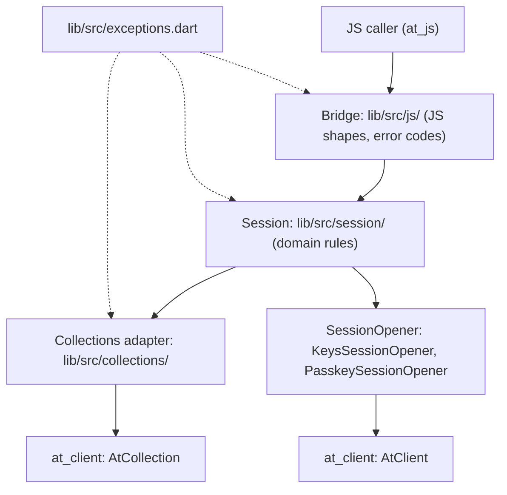

# Proposed layering of `at_client_web` (D-38..D-41, D-45)

**Status: Proposed (D-38..D-41, D-45).** No proposed layer is built on trunk, and this does
not bind until the rows in [`docs/architecture/decisions.md`](../../architecture/decisions.md)
are accepted. The layer allocations this page describes for the closed state, regex compilation, namespace
folding, id lowercasing and error mapping are re-proposed by the implementing PRs, which carry their tests;
D-42..D-44 are reserved for them. Trunk's `at_client_web` has `portalSession`, `passkeyLogin` and
`lib/src/collections/js_collections_adapter.dart`, and no `lib/src/js/` bridge yet;
[`js-api.md`](js-api.md) section 4 says where the facade lives. The "Today" names and
columns below are those of the bridge implementation that follows these decisions (#2537),
not yet on trunk, except these names, which are on trunk too: `portalSession`,
`passkeyLogin`, `PortalSessionOfflineException`, `JsCollectionsError`, `JsCollectionsAdapter`,
`JsItem`, `JsItemAddress`, `JsListing`, `JsWhereClause`, `JsEvent`, `JsUnreadable`, the adapter's `_write`,
`_guard`, `_error` and `_errorId`, and the file `js_collections_adapter.dart`. The names below are the proposed ones; the rename table at the end maps each
to what it is called now.

JS values enter the bridge only at its top layer; below the bridge the session and adapter
layers take typed Dart. Existing platform helpers that need browser
APIs (the passkey, storage and setup helpers under `lib/src/keys/` and `lib/src/session/`) keep their own
`dart:js_interop` use; no decision here moves them behind the opener.



| Layer | Where | Holds | Does not hold |
|---|---|---|---|
| Bridge | `lib/src/js/` (`bridge.dart`, `error_codes.dart`) | The only file in the bridge that touches `dart:js_interop`. `BridgeEntry`, `BridgeSession`, `BridgeCollection`. Shape checks (plain object, own property, string, function, array, finite number, depth), the converters `_toDart`, `_toJs`, `_toRejection`. | Closed-state checks, regex compilation, namespace folding, id lowercasing, key parsing, any rule about what an atSign may do. |
| Session | `lib/src/session/` (`session.dart`, `at_client_session.dart`) | The `Session` interface and `AtClientSession`: the closed state, the namespace folded once in the constructor, the subscribe regex compiled once, incoming senders verified, the `__manage` grant, one decision per enrollment id at a time, one shared teardown that awaits the opener's stop. `SessionBoundCollection`, `ReceivedNotification`, `JsEnrollment`. | Any `dart:js_interop` type in the session interface or its domain rules (platform helpers under `lib/src/session/web_*.dart` keep their own), any error code. |
| Opening | `lib/src/session/` | `SessionOpener` (interface), `KeysSessionOpener`, `PasskeySessionOpener`, sealed `SessionOptions` (`KeysSessionOptions`, `PasskeySessionOptions`), `OpenedSession`. The opener validates its own options, including the root domain. | Anything the bridge needs to know about transports. The bridge no longer imports `portal_session`, `session_transport` or the transport options. |
| Collections adapter | `lib/src/collections/at_collection_adapter.dart` | `ItemCollection` (the eight operations) and `AtCollectionAdapter` over one `AtCollection`: the per-(id, owner) write queue, the id lowercased once, the type check on update, unreadable records listed instead of failing the call, a typed exception. | Codes and message text. |
| Exceptions | `lib/src/exceptions.dart` | Every exception the package declares, each to extend `AtException`: `PortalSessionOfflineException`, `UnsupportedKeyMaterialException`, `JsCollectionsError`, `SetupLockTimeoutException` and `IndexedDbException`, all on trunk today, move into this one file. | Code mapping, which stays in the bridge. |
| Contract manifest | release asset `bridge-manifest.json` | A `schemaVersion`, every exported method and every error code, generated from the Dart constants and identical for both compile targets. at_js downloads it with the bundle, checks its sha256 against `bridge.ref`, and fails when its TypeScript types or code list disagree. | Anything written by hand. |
| Build target | `tool/build.sh`, `at_client_web_bridge_release.yaml` | `--target dart2js\|dart2wasm`: `dart2js` by default; `dart2wasm` is strict, with no silent fallback; an unknown target exits 1. The release workflow takes the target as a dispatch input, read through `env:`, tags a wasm release distinctly (for example `at_client_web-bridge-wasm-<first 12 characters of the SHA>`) and attests every asset. | A target chosen by which entry name is passed. |

## Opening a session (D-40)

The shape, as a sketch; member names are not fixed until the code lands.

```dart
sealed class SessionOptions {}                       // KeysSessionOptions, PasskeySessionOptions
abstract interface class SessionOpener {
  Future<OpenedSession> open(SessionOptions options);
}
final class OpenedSession {                          // what every opener returns
  AtClient get client;
  Future<void> stop();                               // close() awaits this
}
```

`KeysSessionOpener` is today's `portalSession`; `PasskeySessionOpener` is today's
`passkeyLogin`. They are renamed as a pair rather than wrapped. A failure after the opener
has returned stops the opened session before it is rethrown, so a passkey's vault is never
left open. Validation runs first, in a fixed order, before any side effect, and rejects with
an argument error without echoing a value.

## Rename table (D-45)

Rules: each name says what it does and names its layer; siblings share a suffix; an
interface takes the plain noun and an implementation adds a qualifier; nothing pure-Dart
starts with `Js`. JS-facing names (`create`, method names, event shapes, error codes) do not
change. The table lists the names on trunk that change; names introduced in #2537 are not
proposed here.

| Layer | Today | Proposed | Why |
|---|---|---|---|
| Opening | portalSession | KeysSessionOpener | Opens with an .atKeys file |
| Opening | passkeyLogin | PasskeySessionOpener | Sibling of KeysSessionOpener |
| Opening | AtClient + stop (unnamed) | OpenedSession | What every opener returns |
| Opening | PortalSessionOfflineException | SessionOfflineException | Drop "portal" |
| Collection | JsCollectionsAdapter | AtCollectionAdapter | Adapts AtCollection to ItemCollection |
| Collection | JsItem, JsItemAddress, JsListing, JsWhereClause, JsEvent | Item, ItemAddress, ItemListing, WhereClause, CollectionEvent | Drop Js; match at_js names |
| Collection | JsUnreadable | UnreadableItem | Drop Js; match at_js names |
| Collection | _write, _guard, _error | _ownedWrite, _mapFailures, _toCollectionException | Say what each step does |
| Collection | js_collections_adapter.dart | at_collection_adapter.dart | Match the class |
| Exceptions | JsCollectionsError | CollectionException | Drop Js; it is pure Dart |
| Exceptions | spread over four files | lib/src/exceptions.dart | One file (D-41) |

## Reasoning

The five decisions come from a design self-review of #2537, recorded in the first commit of this branch
([`a0fd351bd`](https://github.com/atsign-foundation/at_client_sdk/commit/a0fd351bd9d501aad2f2acd96928806cea4aaf56)) and
carried through #2601. #2537 itself has no review comments, so there is no review thread to link: the self-review is
the originating record. Each block below gives the problem, the alternatives that were actually on the table, the
argument that settled it, and what would reopen it. The "Would reopen if" lines were written for this PR; the review
notes didn't record them.

### D-40 — one way to open a session

**Problem.** Trunk has two opening entry points with different shapes: `portalSession` returns an `AtClient`,
`passkeyLogin` returns a `PasskeySession` with its own stop ([D-40](../../architecture/decisions.md)). A passkey
opener added to the bridge would be a second opening path, and nothing in the bridge waits for the passkey vault to
be released. The names also do not say they are alternatives to each other.

**Options considered.**
- Keep both entry points: rejected because the bridge would carry two opening paths and two teardown rules.
- Wrap both behind one interface: rejected because a wrapper leaves both names in place, so a caller still chooses
  between two entry points.
- Rename the pair and put one interface in front of them (chosen).

**Decision and why.** One `SessionOpener` returning `OpenedSession` (the client and its stop), with
`KeysSessionOpener` and `PasskeySessionOpener`; `close()` awaits the opener's stop. The deciding argument is
teardown: one place waits for the stop, so a passkey's vault is never left open when a later step fails (see
[Opening a session](#opening-a-session-d-40)). The cost is that both trunk names change; `at_client_web` is 0.1.0
and `publish_to: none`, so the rename is internal to its call sites and tests, and `lib/at_client_web_web.dart` must
keep its exports working.

**Would reopen if.** An opener whose teardown can't be expressed as one awaitable stop.

### D-41 — one exceptions file

**Problem.** The package declares five exceptions across four files, and two of them do not extend `AtException`:
`PortalSessionOfflineException` and `UnsupportedKeyMaterialException` are plain `Exception` classes
([`portal_session.dart`](../../../packages/at_client_web/lib/src/session/portal_session.dart)). A caller catching
`AtException` therefore misses them, and a layer has to import another layer just to name its error class. The
[invariants](../../architecture/invariants.md) require an exception raised to a caller to extend `AtException` (A22).

**Options considered.**
- Keep the spread: rejected because two errors stay outside the catch-all and the layers stay coupled by imports.
- Move everything into one file and reuse at_commons' `StoppedException` for the closed session: the original choice
  in [`a0fd351bd`](https://github.com/atsign-foundation/at_client_sdk/commit/a0fd351bd9d501aad2f2acd96928806cea4aaf56),
  taken so that at_commons would not change for a name.
  [`31384cb89`](https://github.com/atsign-foundation/at_client_sdk/commit/31384cb89dae7b0477ff238273525123dbc533ab)
  recorded that the choice needs A22 amended, because
  [`StoppedException`](../../../packages/at_commons/lib/src/exception/stopped_exception.dart) is deliberately not an
  `AtException`.
  [`879e992d8`](https://github.com/atsign-foundation/at_client_sdk/commit/879e992d85fc6c9b7d1f28e3bbc2e90fd54337e9)
  then scoped the decision to the five trunk exceptions: the closed-session type exists only in #2537, so that choice
  and the amendment are left to that PR. If at_commons later gains an `AtException`-based closed-session type, that
  substitution becomes cheap.
- Move the five trunk exceptions into one file and extend `AtException` (chosen). The closed-session type is left to
  the implementing PR, where the #2537-only names live.

**Decision and why.** Domain errors, not JS-specific; follow the existing Dart convention; the layers stop importing
each other for an error class. The cost is a visible change for callers: the two plain `Exception` classes become
`AtException` subclasses, so a catch of `AtException` will begin to see them. The barrel exports must keep working,
and the implementing PR and its release notes must say so.

**Would reopen if.** A caller turns out to depend on `PortalSessionOfflineException` or
`UnsupportedKeyMaterialException` not being caught as `AtException`.

### D-45 — one naming pattern

**Problem.** Trunk has `Js`-prefixed types that are pure Dart (`JsItem`, `JsUnreadable`, `JsListing`, `JsWhereClause`,
`JsEvent`, `JsCollectionsAdapter`), an adapter class with no interface above it, and two opening names that do not say
they are alternatives. There is no rule to apply to a new type, so each name is decided on its own
([D-45](../../architecture/decisions.md)).

**Options considered.**
- Keep the current names: rejected because the `Js` prefix on pure Dart reads as a JS-facing type, and nothing guides
  a new name.
- Rename everything now, including the #2537-only types: rejected for this PR because those names are not on trunk;
  the rename PR settles them.
- Rename the trunk names now under one pattern (chosen).

**Decision and why.** Each name says what it does and names its layer; siblings share a suffix; an interface takes
the plain noun and an implementation adds a qualifier; nothing pure-Dart starts with `Js`; JS-facing names do not
change. The cost is eleven rows in the table above, both opening names, one file rename and one exception rename;
the same 0.1.0 and `publish_to: none` that makes D-40 cheap makes these internal. Names introduced in #2537, such as
`JsEnrollment`, are not proposed here.

**Would reopen if.** A JS-facing name has to change (the rule forbids it), or the package is published before the
renames land, so they would break callers.

### D-39 — a machine-readable contract

**Problem.** The bridge contract is described twice by hand: the code tables in [`js-api.md`](js-api.md) and the code
set in at_js's `error.ts`. Nothing compares either with the bundle, so a code or method can change in one place only
([D-39](../../architecture/decisions.md)).

**Options considered.**
- Keep the hand-kept lists: this is the drift the decision exists to remove.
- Hand-write a manifest: rejected because it would be a third hand-kept list beside [`js-api.md`](js-api.md) and
  at_js's `error.ts`, and would drift the same way.
- Generate the manifest from the Dart constants and ship it with the bundle (chosen).

**Decision and why.** Each release publishes `bridge-manifest.json` with a `schemaVersion`, every exported method and
every error code, identical for both compile targets. at_js downloads it with the bundle, checks its sha256 against
`bridge.ref`, and fails when its TypeScript types or code list disagree. Bridge and at_js types are both hand-written
and nothing checked them against each other; the manifest gives a consumer a machine-readable contract to pin
against.

**Cost.** The release now publishes a manifest and its checksum; additive changes keep `schemaVersion` 1, while a
rename or removal is a bridge-contract major. at_js has to adopt it, which is sequenced with the implementation, not
with this docs PR.

**Would reopen if.** at_js stops being the consumer, or the Dart constants stop being the single source for the
surface.

### D-38 — the compile target

**Problem.** The trunk build script takes no argument: it always runs both compilers, warns and exits 0 when the
dart2wasm build fails unless `WASM_REQUIRED=1`, and writes `at_client.js`. On trunk no workflow publishes the bridge. The target is
therefore implicit in whatever the script last ran, and a failed wasm build can leave a dart2js-only artifact ([D-38](../../architecture/decisions.md)).

**Options considered.**
- Keep the dual-build script: rejected because the target stays implicit and a wasm failure can pass silently.
- Keep dart2js as the primary target: D-38 does not reopen this. It keeps `dart2js` as the default, which is the
  position of [wasm D-7](decisions.md), and D-7 already keeps `dart2wasm` available "at zero cost". The measured
  evidence favoured dart2js: one 77 KB file (24.5 KB gzipped) against dart2wasm's four files at about 25 KB gzipped, and
  Sass ships dart2js ([js-api.md](js-api.md) section 2). D-38 decides how a wasm build is made and shipped, not
  which target is primary.
- A `--target` flag with `dart2js` as the default (chosen).

**Decision and why.** `tool/build.sh` takes `--target dart2js|dart2wasm`; `dart2js` is the default, `dart2wasm` is
strict with no silent fallback, and an unknown target exits 1. The deciding argument is that the entry already
compiles under both compilers (`test/web/compile_test.dart`), so the cost is in the build script, not in the bridge.

**Cost.** Two release targets to keep green, and a wasm release is a separate prerelease under its own tag and
advisory (OQ-16), so it does not replace the default.

**Would reopen if.** The bridge stops being target-agnostic, or the wasm line is dropped; product sign-off on the
advisory wasm release is still open (OQ-16).
