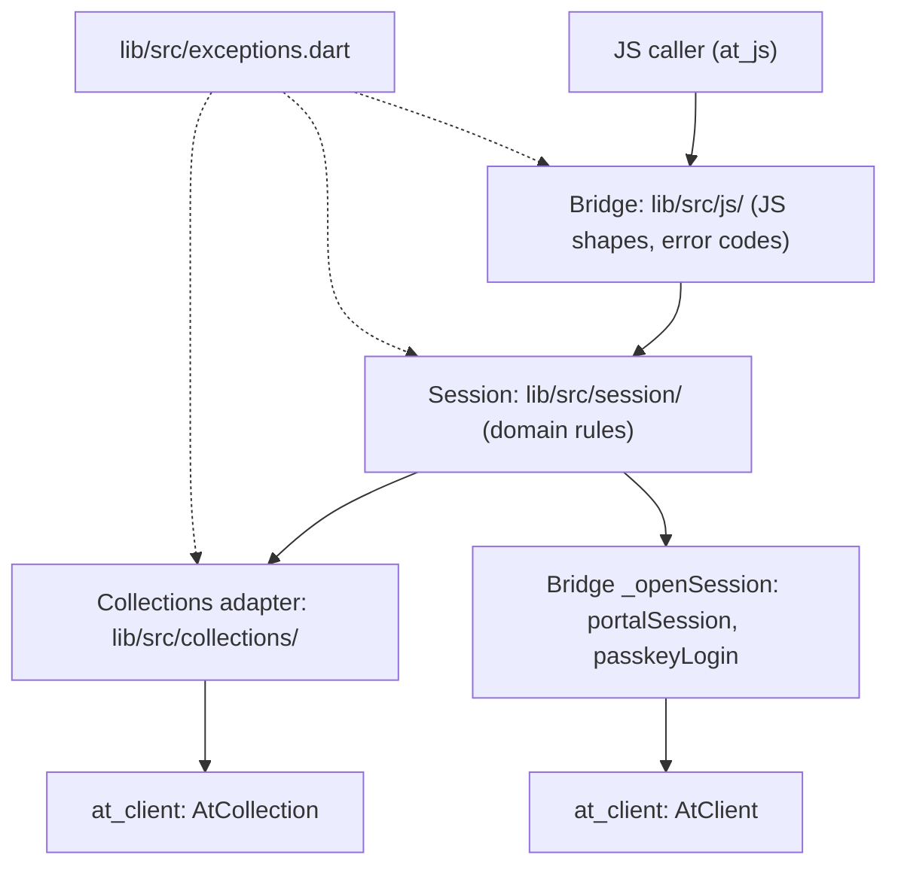

# Proposed layering of `at_client_web` (D-38..D-41)

**Status: Proposed (D-38..D-41).** No proposed layer is built on trunk, and this does
not bind until the rows in [`docs/architecture/decisions.md`](../../architecture/decisions.md)
are accepted. The layer allocations this page describes for the closed state, regex compilation, namespace
folding, id lowercasing and error mapping are re-proposed by the implementing PRs, which carry their tests;
D-42..D-44 are reserved for them. Trunk's `at_client_web` has `portalSession`, `passkeyLogin` and
`lib/src/collections/js_collections_adapter.dart`, and no `lib/src/js/` bridge yet;
[`js-api.md`](js-api.md) section 4 says where the facade lives. The "Today" column below is the bridge implementation that follows these decisions (#2537), not yet on
trunk, except `portalSession`, `passkeyLogin` and the trunk names listed under Names. Trunk names are kept.

JS values enter the bridge only at its top layer; below the bridge the session and adapter
layers take typed Dart. Existing platform helpers that need browser
APIs (the passkey, storage and setup helpers under `lib/src/keys/` and `lib/src/session/`) keep their own
`dart:js_interop` use; no decision here moves them behind the opener.

| Layer | Where | Holds | Does not hold |
|---|---|---|---|
| Bridge | `lib/src/js/` (`bridge.dart`, `error_codes.dart`) | The only file in the bridge that touches `dart:js_interop`. `BridgeEntry`, `BridgeSession`, `BridgeCollection`. Shape checks (plain object, own property, string, function, array, finite number, depth), the converters `_toDart`, `_toJs`, `_toRejection`. | Closed-state checks, regex compilation, namespace folding, id lowercasing, key parsing, any rule about what an atSign may do. |
| Session | `lib/src/session/` (`at_client_session.dart`) | The `Session` interface and `AtClientSession`: the closed state, the namespace folded once in the constructor, the subscribe regex compiled once, incoming senders verified, the `__manage` grant, one decision per enrollment id at a time, one shared teardown that awaits the opener's stop. `SessionBoundCollection`, `ReceivedNotification`, `JsEnrollment`. | Any `dart:js_interop` type in the session interface or its domain rules (platform helpers under `lib/src/session/web_*.dart` keep their own), any error code. |
| Opening | `lib/src/js/bridge.dart` (`_openSession`, behind the `OpenJsSession` seam); `lib/src/session/session_options.dart` | One private function opens a keys session on `portalSession` or a passkey session on `passkeyLogin` and hands `AtClientSession` the stop that `close()` awaits. The sealed `SessionOptions` (`KeysSessionOptions`, `PasskeySessionOptions`) validate themselves, including the root domain, which they parse once from its `host` or `host:port` text; the bridge only checks that it is a string. Nothing here is exported from the package barrels. | An exported opener family. |
| Collections adapter | `lib/src/collections/js_collections_adapter.dart` | `ItemCollection` (the eight operations) and `JsCollectionsAdapter` over one `AtCollection`: the per-(id, owner) write queue, the id lowercased once, the type check on update, unreadable records listed instead of failing the call, a typed exception. | Codes and message text. |
| Exceptions | `lib/src/exceptions.dart` | Every exception the package declares, each extending `AtException` (`EnrollmentInFlightException` through `AtEnrollmentException`, itself an `AtException`): `InvalidArgumentException`, `SessionClosedException`, `UnsupportedOperationException`, `InvalidKeyException`, `ManageAccessRequiredException`, `EnrollmentInFlightException`, `PortalSessionOfflineException`, `UnsupportedKeyMaterialException`, `SetupLockTimeoutException`, `IndexedDbException` and `JsCollectionsError`. Trunk names `UnsupportedKeyMaterialException`, `SetupLockTimeoutException` and `IndexedDbException` and `PortalSessionOfflineException` keep their names and move into this one file; `JsCollectionsError` keeps its name and now extends `AtException`, with no alias for any of them. | Code mapping, which stays in the bridge. |
| Contract manifest | release asset `bridge-manifest.json` | A `schemaVersion`, every exported method and every error code, generated from the Dart constants and identical for both compile targets. at_js downloads it with the bundle, checks its sha256 against `bridge.ref`, and fails when its TypeScript types or code list disagree. | Anything written by hand. |
| Build target | `tool/build.sh`, the bridge release workflow (ships separately) | Today `tool/build.sh` has no target flag: with no argument it builds both entries (dart2js, plus dart2wasm, whose failure warns unless `WASM_REQUIRED=1`), `at_client_bridge_entry` builds only the bridge with dart2js, and any other argument exits 1; the release workflow, which ships separately, builds the dart2js bridge only and has no target input. The `--target dart2js\|dart2wasm` flag (`dart2js` by default; `dart2wasm` strict, no silent fallback; an unknown target exits 1), the dispatch input read through `env:`, a distinct wasm tag (for example `at_client_web-bridge-wasm-<first 12 characters of the SHA>`) and attestation of every asset land with the release follow-up PR. | A target chosen by which entry name is passed. |

## Opening a session (D-40)

There is no public opener type. `BridgeEntry` takes an `OpenJsSession` (`Future<Session> Function(SessionOptions)`),
a test seam that is in no barrel; its default, the private `_openSession` in `lib/src/js/bridge.dart`, switches on
the sealed `SessionOptions`: `KeysSessionOptions` go to `portalSession` over `sessionTransport`, `PasskeySessionOptions`
to `passkeyLogin`. The session's `close()` awaits the stop recorded at open: the client's own `stop()` for keys, the
passkey session's (which also closes its vault) for a passkey. A keys session's close is bounded only by the client's
`stop()`; the bridge adds no bound of its own. Validation runs first, in a fixed order, before any side effect, and
rejects with an argument error without echoing a value.

## Names

Names on trunk keep their trunk names: `PortalSessionOfflineException`, `JsCollectionsAdapter`, `JsItem`,
`JsItemAddress`, `JsListing`, `JsWhereClause`, `JsEvent`, `JsUnreadable`, `JsCollectionsError` and the file `js_collections_adapter.dart`. The only trunk name
that moves is `JsCollectionsError`'s file: it joins the other exceptions in `lib/src/exceptions.dart` (D-41).

## Reasoning

The five decisions come from a design self-review of #2537, recorded in the first commit of this branch
([`a0fd351bd`](https://github.com/atsign-foundation/at_client_sdk/commit/a0fd351bd9d501aad2f2acd96928806cea4aaf56)) and
carried through #2601. #2537 itself has no review comments, so there is no review thread to link: the self-review is
the originating record. Each block below gives the problem, the alternatives that were actually on the table, the
argument that settled it, and what would reopen it. Where the review notes did not record a reason, the line is
marked **[reconstructed: confirm]** so it can be filled in rather than ratified as something nobody argued.

### D-40 — one way to open a session

**Problem.** Trunk has two opening entry points with different shapes: `portalSession` returns an `AtClient`,
`passkeyLogin` returns a `PasskeySession` with its own stop ([D-40](../../architecture/decisions.md)). A passkey
opener added to the bridge would be a second opening path, and nothing in the bridge waits for the passkey vault to
be released. The names also do not say they are alternatives to each other.

**Options considered.**
- Keep both entry points: rejected because the bridge would carry two opening paths and two teardown rules.
- Wrap both behind one interface: rejected because a wrapper leaves both names in place, so a caller still chooses
  between two entry points.
- Rename the pair and put one interface in front of them (chosen).

**Decision and why.** One private bridge function, behind the `OpenJsSession` seam, opens either kind and records the
stop; `close()` awaits it. No opener type is public. The deciding argument is
teardown: one place waits for the stop, so a passkey's vault is never left open when a later step fails (see
[Opening a session](#opening-a-session-d-40)). The cost is that both trunk names change; `at_client_web` is 0.1.0
and `publish_to: none`, so the rename is internal to its call sites and tests, and `lib/at_client_web_web.dart` must
keep its exports working.

**Would reopen if.** A third opening path appears that does not fit `SessionOptions`, or the one function cannot record a
single stop. **[reconstructed: confirm]**

### D-41 — one exceptions file

**Problem.** The package declares five exceptions across four files, and two of them do not extend `AtException`:
`PortalSessionOfflineException` and `UnsupportedKeyMaterialException` are plain `Exception` classes
([`portal_session.dart`](../../../packages/at_client_web/lib/src/session/portal_session.dart)). A caller catching
`AtException` therefore misses them, and a layer has to import another layer just to name its error class. The
[invariants](../../architecture/invariants.md) require an exception raised to a caller to extend `AtException` (A22).

**Options considered.**
- Keep the spread: rejected because two errors stay outside the catch-all and the layers stay coupled by imports.
- Move everything into one file but reuse at_commons' `StoppedException` for the closed-session case: rejected
  because [`StoppedException`](../../../packages/at_commons/lib/src/exception/stopped_exception.dart) is deliberately
  not an `AtException` (its doc says a fallback catch should not read a stop as an ordinary failure), so raising it
  to a caller would amend A22; changing at_commons for a name was not worth it.
- Move the five trunk exceptions into one file and extend `AtException` (chosen). The closed-session type is left to
  the implementing PR, where the #2537-only names live.

**Decision and why.** Domain errors, not JS-specific; follow the existing Dart convention; the layers stop importing
each other for an error class. The cost is a visible change for callers: the two plain `Exception` classes become
`AtException` subclasses, so a catch of `AtException` will begin to see them. The barrel exports must keep working,
and the implementing PR and its release notes must say so.

**Would reopen if.** at_commons gains an `AtException`-based closed-session type, which would make the substitution
cheap. **[reconstructed: confirm]**

### D-39 — a machine-readable contract

**Problem.** The bridge contract is described twice by hand: the code tables in [`js-api.md`](js-api.md) and the code
set in at_js's `error.ts`. Nothing compares either with the bundle, so a code or method can change in one place only
([D-39](../../architecture/decisions.md)).

**Options considered.**
- Keep the hand-kept lists: this is the drift the decision exists to remove.
- Hand-write a manifest: rejected by the decision's "anything written by hand" rule; a third hand-kept list would
  drift the same way.
- Generate the manifest from the Dart constants and ship it with the bundle (chosen).

**Decision and why.** Each release publishes `bridge-manifest.json` with a `schemaVersion`, every exported method and
every error code, identical for both compile targets. at_js downloads it with the bundle, checks its sha256 against
`bridge.ref`, and fails when its TypeScript types or code list disagree. Bridge and at_js types are both hand-written
and nothing checked them against each other; the manifest gives a consumer a machine-readable contract to pin
against.

**Cost.** The release now publishes a manifest and its checksum; additive changes keep `schemaVersion` 1, while a
rename or removal is a bridge-contract major. at_js has to adopt it, which is sequenced with the implementation, not
with this docs PR.

**Would reopen if.** at_js stops being the consumer, or the Dart constants stop being the single source for the
surface. **[reconstructed: confirm]**

### D-38 — the compile target

**Problem.** The trunk build script takes no argument: it always runs both compilers, warns and exits 0 when the
dart2wasm build fails unless `WASM_REQUIRED=1`, and writes `at_client.js`. The release ships the dart2js bundle only.
The target is therefore implicit in whatever the script last ran, and a failed wasm build can leave a dart2js-only
artifact ([D-38](../../architecture/decisions.md)).

**Options considered.**
- Keep the dual-build script: rejected because the target stays implicit and a wasm failure can pass silently.
- Make the target package configuration: rejected because the bridge code is target-agnostic (`dart:js_interop`);
  only the compiler changes, so this is a build choice, not package configuration.
- Keep dart2js as the only target (the older project decision): rejected because the same source remains wasm-ready
  at no source cost; the open question is how to build and ship it, not whether to keep the source compatible.
- A `--target` flag with `dart2js` as the default (chosen).

**Decision and why.** `tool/build.sh` takes `--target dart2js|dart2wasm`; `dart2js` is the default, `dart2wasm` is
strict with no silent fallback, and an unknown target exits 1. The release workflow takes the target as a dispatch
input, reads it through `env:`, tags a wasm release distinctly and attests every asset. The deciding argument is that
the source is already target-agnostic, so the cost is in the build and release plumbing, not in the bridge.

**Cost.** Two release targets to keep green, and a wasm release is a separate prerelease under its own tag and
advisory (OQ-16), so it does not replace the default.

**Would reopen if.** The bridge stops being target-agnostic **[reconstructed: confirm]**, or the wasm line is
dropped; product sign-off on the advisory wasm release is still open (OQ-16).
