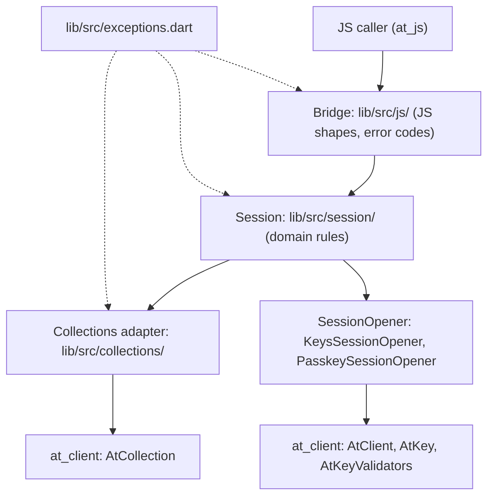

# Proposed layering of `at_client_web` (D-38..D-45)

**Status: Proposed (D-38..D-45).** Nothing in this document is built on trunk, and it does
not bind until the rows in [`docs/architecture/decisions.md`](../../architecture/decisions.md)
are accepted. Trunk's `at_client_web` has `portalSession`, `passkeyLogin` and
`lib/src/collections/js_collections_adapter.dart`, and no `lib/src/js/` bridge yet;
[`js-api.md`](js-api.md) section 4 says where the facade lives. The "Today" names and
columns below are those of the bridge implementation that follows these decisions (#2537),
not yet on trunk, except these names, which are on trunk too: `portalSession`,
`passkeyLogin`, `PortalSessionOfflineException`, `JsCollectionsError`, `JsCollectionsAdapter`,
`JsItem`, `JsItemAddress`, `JsListing`, `JsWhereClause`, `JsEvent`, the adapter's `_write`,
`_guard`, `_error` and `_errorId`, and the file `js_collections_adapter.dart`. The names below are the proposed ones; the rename table at the end maps each
to what it is called now.

JS values enter the bridge only at its top layer; below the bridge the session, adapter and key-format
layers take typed Dart, and each check lives in one layer. Existing platform helpers that need browser
APIs (the passkey, storage and setup helpers under `lib/src/keys/` and `lib/src/session/`) keep their own
`dart:js_interop` use; no decision here moves them behind the opener.



| Layer | Where | Holds | Does not hold |
|---|---|---|---|
| Bridge | `lib/src/js/` (`bridge.dart`, `error_codes.dart`) | The only file in the bridge that touches `dart:js_interop`. `BridgeEntry`, `BridgeSession`, `BridgeCollection`. Shape checks (plain object, own property, string, function, array, finite number, depth), the converters `_toDart`, `_toJs`, `_toRejection`, and the mapping from an exception to a code and a fixed message (`errorCodeOf`), including the collection codes. | Closed-state checks, regex compilation, namespace folding, id lowercasing, key parsing, any rule about what an atSign may do. |
| Session | `lib/src/session/` (`session.dart`, `at_client_session.dart`) | The `Session` interface and `AtClientSession`: the closed state, the namespace folded once in the constructor, the subscribe regex compiled once, notify keys validated through at_client, incoming senders verified, the `__manage` grant, one decision per enrollment id at a time, one shared teardown that awaits the opener's stop. `SessionBoundCollection`, `NotifyKey`, `ReceivedNotification`, `PendingEnrollment`. | Any `dart:js_interop` type in the session interface or its domain rules (platform helpers under `lib/src/session/web_*.dart` keep their own), any error code. |
| Opening | `lib/src/session/` | `SessionOpener` (interface), `KeysSessionOpener`, `PasskeySessionOpener`, sealed `SessionOptions` (`KeysSessionOptions`, `PasskeySessionOptions`), `OpenedSession`. The opener validates its own options, including the root domain. | Anything the bridge needs to know about transports. The bridge no longer imports `portal_session`, `session_transport` or the transport options. |
| Collections adapter | `lib/src/collections/at_collection_adapter.dart` | `ItemCollection` (the eight operations) and `AtCollectionAdapter` over one `AtCollection`: the per-(id, owner) write queue, the id lowercased once, the type check on update, unreadable records listed instead of failing the call, `CollectionException` with a kind. | Codes and message text. |
| Exceptions | `lib/src/exceptions.dart` | Every exception the layers throw, each extending `AtException`. One exception sits outside that hierarchy: at_commons' `StoppedException`, used as is for a call on a closed session (it replaces `SessionClosedException`); at_commons is not changed. The pairing guard's `EnrollmentInFlightException` extends `AtEnrollmentException`. | Code mapping, which stays in the bridge. |
| Key format | `at_client` | `AtKey.fromString` and `AtKeyValidators`. The session parses and validates with them. The bridge rejects `public:` and `cached:` keys as argument-shape errors (`invalid_argument`). | A key parser in the session, or in at_js beyond the shape its callers see. |
| Contract manifest | release asset `bridge-manifest.json` | A `schemaVersion`, every exported method and every error code, generated from the Dart constants and identical for both compile targets, plus the shared key-format cases. at_js downloads it with the bundle, checks its sha256 against `bridge.ref`, and fails when its TypeScript types, code list or `parseKey` disagree. | Anything written by hand. |
| Build target | `tool/build.sh`, `at_client_web_bridge_release.yaml` | `--target dart2js\|dart2wasm`: `dart2js` by default; `dart2wasm` is strict, with no silent fallback; an unknown target exits 1. The release workflow takes the target as a dispatch input, read through `env:`, tags a wasm release distinctly (for example `at_client_web-bridge-wasm-<first 12 characters of the SHA>`) and attests every asset. | A target chosen by which entry name is passed. |

## Opening a session (D-40)

The shape, as a sketch; member names are not fixed until the code lands.

```dart
sealed class SessionOptions {}                       // KeysSessionOptions, PasskeySessionOptions
abstract interface class SessionOpener {
  Future<OpenedSession> open(SessionOptions options);
}
final class OpenedSession {                          // what every opener returns
  AtClient get client;
  Future<void> stop();                               // close() awaits this
}
```

`KeysSessionOpener` is today's `portalSession`; `PasskeySessionOpener` is today's
`passkeyLogin`. They are renamed as a pair rather than wrapped. A failure after the opener
has returned stops the opened session before it is rethrown, so a passkey's vault is never
left open. Validation runs first, in a fixed order, before any side effect, and rejects with
`invalid_argument` without echoing a value.

## One check in one layer (D-42)

| Check | Today | Proposed |
|---|---|---|
| Session closed | `BridgeCollection._open()` and its `isClosed` guards, and the session's own | The session's only |
| Subscribe regex compiled | Bridge `subscribe` and session `subscribe` | The session only |
| Namespace folded | Bridge `_options`, session constructor, `qualified()`, `_atKey` | The session constructor once; `_namespace` is trusted afterwards |
| Id lowercased | Adapter `_serialize` and `_errorId`, bridge `_address` | The adapter once |
| Log text sanitised | A pattern in the bridge and the same pattern in the adapter | One shared helper |

## Rename table (D-45)

Rules: each name says what it does and names its layer; siblings share a suffix; an
interface takes the plain noun and an implementation adds a qualifier; nothing pure-Dart
starts with `Js`. JS-facing names (`create`, method names, event shapes, error codes other
than `invalid_argument` and `enrollment_in_flight`) do not change.

| Layer | Today | Proposed | Why |
|---|---|---|---|
| Bridge | AtClientWebBridge | BridgeEntry | Sibling of BridgeSession / BridgeCollection; the entry point JS loads |
| Bridge | BridgeSession, BridgeCollection | unchanged | Already follow the pattern |
| Bridge | _fromJs, _jsValue, _rejection | _toDart, _toJs, _toRejection | Three converters, one shape |
| Bridge | _expected, _required | _invalidArgument, _missingArgument | Say which error they build |
| Bridge | atErrorCode (js/at_error_code.dart) | errorCodeOf (js/error_codes.dart) | Bridge-only mapping (D-43) |
| Opening | SessionOpener (typedef) | SessionOpener (interface) | The D-40 abstraction |
| Opening | portalSession | KeysSessionOpener | Opens with an .atKeys file |
| Opening | passkeyLogin | PasskeySessionOpener | Sibling of KeysSessionOpener |
| Opening | BridgeOptions | sealed SessionOptions: KeysSessionOptions, PasskeySessionOptions | Input to the opener, not bridge-specific |
| Opening | AtClient + stop (unnamed) | OpenedSession | What every opener returns |
| Opening | PortalSessionOfflineException | SessionOfflineException | Drop "portal" |
| Session | JsSession (interface) | Session | Plain noun for the interface |
| Session | AtClientJsSession (js/js_session.dart) | AtClientSession (session/at_client_session.dart) | Pure Dart; out of js/ |
| Session | _SessionCollection | SessionBoundCollection | Lives and dies with the session |
| Session | JsKey | NotifyKey | The narrow notify key (D-44) |
| Session | JsNotification | ReceivedNotification | What subscribe delivers |
| Session | JsEnrollment | PendingEnrollment | Same name as at_js |
| Session | qualified | qualifiedCollectionName | Says what it qualifies |
| Session | _sender | _verifiedSender | It verifies |
| Session | _decide | _decideExclusively | One decision per id at a time |
| Collection | JsCollection (interface) | ItemCollection | Plain noun for the eight operations |
| Collection | JsCollectionsAdapter | AtCollectionAdapter | Adapts AtCollection to ItemCollection |
| Collection | JsItem, JsItemAddress, JsListing, JsWhereClause, JsEvent | Item, ItemAddress, ItemListing, WhereClause, CollectionEvent | Drop Js; match at_js names |
| Collection | _serialize, _write, _guard, _error | _queueWrite, _ownedWrite, _mapFailures, _toCollectionException | Say what each step does |
| Collection | nestsTooDeep, itemTooDeep | exceedsMaxDepth, ItemTooDeepException | A check and an exception |
| Collection | js_collections_adapter.dart | at_collection_adapter.dart | Match the class |
| Exceptions | JsCollectionsError | CollectionException | An AtException with a kind, not a code (D-43) |
| Exceptions | BadKeyException | InvalidKeyException | Says what is wrong |
| Exceptions | ManageAccessException | ManageAccessRequiredException | Says what is missing |
| Exceptions | SessionClosedException | dropped for StoppedException | Duplicate (D-41) |
| Exceptions | _BridgeArgumentError | InvalidArgumentException | Maps to invalid_argument |
| Exceptions | (new) | EnrollmentInFlightException | Maps to enrollment_in_flight |
| Exceptions | spread over four files | lib/src/exceptions.dart | One file (D-41) |
