# PB-3 — the storage bundle, remote-only client and io split

**Status:** six stages, all PRs open and unmerged as of 2026-10-18 (checked with `gh`). Merge order and the publish ladder live in the landing plan, not here.
**Purpose:** the delivered record of PB-3 — what each stage changed in `at_client`, why, and what its tests prove. It merges the former `pb3-stage1.md` … `pb3-stage6.md`; per-PR status was dropped, so this table is the only place state is recorded.
**Rulings it implements:** [`decisions.md`](decisions.md) D-12 (storage bundle), D-17 (V1 ships remote-only), D-18 (remote-only is an `AtClientStorage` implementation), D-13/D-14 (location per atSign). Gates: [`acceptance.md`](acceptance.md) §9a.2, X-R1/X-R2.
**Not here:** the web crypto and web lookups (PB-4), `at_client_wasm` sessions and the JS entry (PB-5) — see [`implementation-plan.md`](implementation-plan.md).

## The stack

```mermaid
graph LR
  T[trunk] --> S1["#2257 stage 1<br/>Mode E constructs"]
  S1 --> S2a["#2258 2a<br/>NoopSyncQueueStore"]
  S2a --> S2b["#2259 2b<br/>RemoteWriteThroughKeyStore"]
  S2b --> S2c["#2260 2c<br/>RemoteOnlyAtClientStorage"]
  S2c --> S3["#2261 stage 3<br/>key-material precondition"]
  S3 --> S4["#2262 stage 4<br/>hive.dart barrel"]
  S4 --> S5["#2263 stage 5<br/>io split + CI gate"]
  S5 --> S6a["#2273 6a<br/>remote_only gate"]
  S6a --> S6b["#2274 6b<br/>write-through get fix"]
  S6b --> S6c["#2275 6c<br/>WriteThroughSyncService"]
  S6c --> S6d["#2276 6d<br/>X-R2 interop"]
  S6d --> F["#2336<br/>timer-gate + rederive fixes"]
```

| Stage | PR | State | Delivers | Breaking |
|---|---|---|---|---|
| [1](#stage-1) | [#2257](https://github.com/atsign-foundation/at_client_sdk/pull/2257) | open, ready, base `trunk` | A non-Hive bundle with `isLocalStoreRequired: false` constructs; chops setup no longer gated on local store | no |
| [2](#stage-2) | [#2258](https://github.com/atsign-foundation/at_client_sdk/pull/2258), [#2259](https://github.com/atsign-foundation/at_client_sdk/pull/2259), [#2260](https://github.com/atsign-foundation/at_client_sdk/pull/2260) | open, ready | `NoopSyncQueueStore`, `RemoteWriteThroughKeyStore`, `RemoteOnlyAtClientStorage` (`package:at_client/remote_only.dart`) | no |
| [3](#stage-3) | [#2261](https://github.com/atsign-foundation/at_client_sdk/pull/2261) | open, ready | `AtClientStorage.holdsKeyMaterial`; remote-only client without keys fails at construction | no |
| [4](#stage-4) | [#2262](https://github.com/atsign-foundation/at_client_sdk/pull/2262) | open, **draft** | `HiveAtClientStorage` moves to `package:at_client/hive.dart`; conditional default storage | **yes** (`at_client` 4.0.0) |
| [5](#stage-5) | [#2263](https://github.com/atsign-foundation/at_client_sdk/pull/2263) | open, **draft** | No `dart:io` in `at_client.dart`; deprecated file/stream API deleted; wasm gate stanza | **yes** (`at_client` 4.0.0) |
| [6](#stage-6) | [#2273](https://github.com/atsign-foundation/at_client_sdk/pull/2273)–[#2276](https://github.com/atsign-foundation/at_client_sdk/pull/2276) | open, 6a–6d ready | `remote_only.dart` wasm gate; write-through `get` key fix; `replicatesServer` + `WriteThroughSyncService`; X-R2 interop test | no |
| follow-up | [#2336](https://github.com/atsign-foundation/at_client_sdk/pull/2336) | open, base stage 6d | `at_client` timer-gate and rederive fixes found by the PB-5 sessions work | no |

Stages 1–3 are additive; the breaking changes are in 4 and 5 and ride `at_client` 4.0.0. Each of those stages has a migration section for consumers.

**Glossary trap.** "R3" means three different things across the doc set: PB-3 item e/R3 (key material is a precondition of a remote-only client; stage 1 hoist + stage 3 guard), `implementation-plan.md` R3 (the no-throwing-stub gate), and `acceptance.md` X-R3 (a write is not acknowledged until the atServer accepts it).

---

<a id="stage-1"></a>

## Stage 1 — unblock Mode E construction in `at_client`

### The gap

D-18 named this exactly, from the storage-bundle side (`decisions.md`, "the gateway must
admit a remote-only bundle", item 2):

> The `isLocalStoreRequired` guard must not reach the bundle path. `at_client_impl.dart:824`
> currently throws when a keystore is injected while `preference.isLocalStoreRequired` is
> false — exactly backwards for this design.

Two call sites carried that backwardness:

- `at_client_factory.dart:71-77` refused **any** injected storage when the flag was false —
  not just Hive, which is the only backend the flag actually protects (a Hive box on disk
  with nothing configured to read it back).
- `at_client_impl.dart`'s `_init` gated **all** of chops/crypto setup, plus the expiry/
  availability timers, behind that same flag. A no-storage config (flag false, nothing
  injected) skipped chops entirely instead of falling back to its existing no-key-material
  path — so `atChops` came back `null` even in configs several existing tests already
  exercised.

### What changed

**`at_client_factory.dart`** — narrowed the guard to the backend it's actually protecting:

```dart
if (storage is HiveAtClientStorage && !preference.isLocalStoreRequired) {
  throw ArgumentError.value(storage, 'storage', ...);
}
```

A non-Hive bundle (a fake today, `RemoteOnlyAtClientStorage` once it exists) now
constructs under `isLocalStoreRequired: false`.

**`at_client_impl.dart`'s `_init`** — split one `if (isLocalStoreRequired)` into three
independently-gated blocks:

| Block | Gate | Why |
| --- | --- | --- |
| Storage / `localSecondary` | `injected storage != null \|\| isLocalStoreRequired` | unchanged behavior, just widened to admit the injected case |
| Chops / crypto | unconditional | D-18's point: whether the bundle is durable is the bundle's business, not a reason to skip key material entirely |
| Expiry / availability timers | `isLocalStoreRequired` only | a write-through remote store rearming on TTL is a separate design question, out of scope here (see [Scope](#scope)) |

`_createAtChops`'s no-`atKeysIo` branch read `localSecondary!.get...Key` with non-null
assertions; once chops runs unconditionally, a genuinely-empty config (`localSecondary ==
null`) hits those reads. Changed to `localSecondary?.` so that config degrades to the
existing no-key-material fallback (an `AtChopsImpl` built from null keypairs, already
logged as such) instead of throwing an NPE.

### Scope

This ships the *precondition* for D-17/D-18's remote-only lane, not the lane itself.
`RemoteOnlyAtClientStorage` — the concrete write-through bundle `implementation-plan.md`
names as "implied and not yet written up" — does not exist in this repo. Stage1 only makes
the factory/`_init` seam accept *any* non-Hive `AtClientStorage`; tests here use a fake
(`InMemoryAtClientStorage`) in its place. X-R1 (constructs with no Hive/SQLite in-process)
and X-R2 (reads data written by a local-storage client) stay open until that bundle lands.

Also explicitly out of stage1, filed as follow-ups rather than silently dropped:

- **Barrel split** — `at_client.dart` exports both Hive and `at_lookup_io.dart`'s
  `secureSocketLookUps`; a Hive-only split doesn't make the barrel wasm-safe alone, so it's
  one follow-up covering both, not part of this slice.
- **`withSecureSocket` caller sweep** — verification-only, a PR-description checklist item,
  not a code change.
- Timer rearming under a write-through remote store (mentioned above) — a separate design
  question.

### Tests

`packages/at_client/test/at_client_mode_e_construction_test.dart` (new, 4 cases) plus
targeted additions to `at_client_create_test.dart`, `no_commit_test.dart`,
`put_request_test.dart`. Full Hive-path regression
(`create_at_chops_logging_test.dart`, `side_by_side_storage_test.dart`,
`at_client_impl_test.dart`) unaffected.

### Open question, not resolved here

D-17's amendment and D-18 both describe this gap as still open as of their last edit.
Whether to update those entries to point at this doc (vs. leaving their dated history
untouched and letting this file be the forward reference) is a call for whoever owns
`decisions.md` — not made unilaterally in this pass.

---

<a id="stage-2"></a>

## Stage 2 — the remote-only storage bundle: no-op queue, write-through keystore, `RemoteOnlyAtClientStorage`

**Bottom line:**
- `at_client` now has a concrete remote-only `AtClientStorage`: `RemoteOnlyAtClientStorage`, exported from `package:at_client/remote_only.dart`.
- It composes two new parts. `NoopSyncQueueStore` keeps nothing on disk. `RemoteWriteThroughKeyStore` sends every read and write straight to the atServer through `RemoteSecondary`.
- `local:` keys never reach the atServer. They stay in memory for the session.
- **A client built with `buildAtClient(storage: RemoteOnlyAtClientStorage(...))` under `isLocalStoreRequired: false` constructs.** Stage1 made that shape legal; stage2 fills it.


---

### Where this sits in PB-3

D-18 "Remote-only is delivered as an `AtClientStorage` implementation, not by making `localSecondary` nullable" says `at_client` never learns about a "no local store" mode. It gets a bundle whose keystore is write-through and whose sync queue is a no-op. Stage2 builds exactly that bundle, one part per PR.

| PR | Branch | Adds | Files | Tests added |
|---|---|---|---|---|
| #2258 | `st/wasm/stage2a-noop-sync-queue` | `NoopSyncQueueStore` in `lib/src/sync/sync_queue_store.dart` | 2, +92 | 5 |
| #2259 | `st/wasm/stage2b-write-through-keystore` | `lib/src/storage/remote_write_through_keystore.dart` | 2, +618 | 25 |
| #2260 | `st/wasm/stage2c-remote-only-storage` | `lib/src/storage/remote_only_at_client_storage.dart`, `lib/remote_only.dart` | 3, +269 | 6 |

#### How the bundle composes

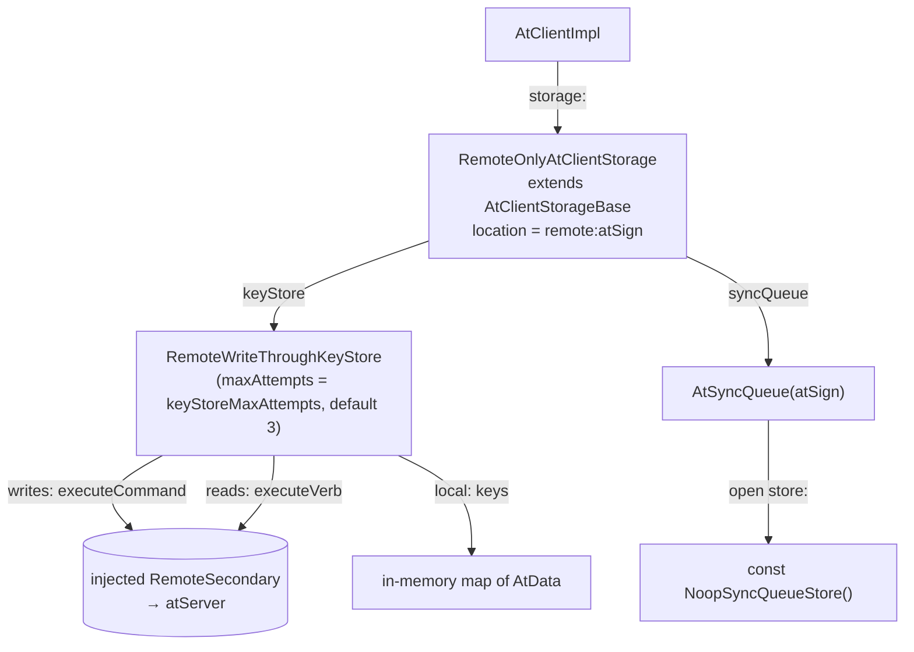

---

### 2a — `NoopSyncQueueStore`

#### Why

- D-18 item 1: "The no-op queue is supplied, not evaded." Since X2/X3, `LocalSecondary` takes an injected sync queue, so the remote-only bundle supplies one instead of avoiding the Hive-backed default.
- **Delivery already happens synchronously in the write-through keystore's own retry.** So there is nothing left for a queue to redeliver across a restart, and nothing to persist.

#### What

A `const` class in `lib/src/sync/sync_queue_store.dart`, beside `HiveBoxSyncQueueStore`.

| Member | Behaviour |
|---|---|
| `keys` | `const Iterable.empty()` |
| `get(atKey)` | `null` |
| `put`, `delete`, `clear`, `close` | no-op `async {}` |

`AtSyncQueue`'s in-memory FIFO is independent of the store. An `enqueue` still counts for the current process; it just never survives a reopen.

#### Tests

5 tests added in `test/noop_sync_queue_store_test.dart`.

| Group | What it checks |
|---|---|
| `NoopSyncQueueStore` | `keys` empty and `get` null; `put` then `get` still null; `clear`/`close` complete |
| `AtSyncQueue.open with NoopSyncQueueStore` | Opens and enqueues without touching Hive (`size` 1 after enqueue); a fresh `open()` on a new `AtSyncQueue` replays nothing (`size` 0) |

---

### 2b — `RemoteWriteThroughKeyStore`

#### Why

- D-18 item 3 bars rebuilding `AtChops` from a store that never held the keys. The remote-only bundle has **no durable keystore at all**, and a write-through one is legal for it.
- Every read and write therefore goes straight to the atServer through `RemoteSecondary`. There is no local commit log.

#### What

`RemoteWriteThroughKeyStore implements AtKeyValueStore<String, AtData, AtMetaData?>`, constructed as `RemoteWriteThroughKeyStore(remoteSecondary, {maxAttempts = 3})`.

| Member | Wire form | Via |
|---|---|---|
| `put` | `update:<key> <data>` | `executeCommand(…, auth: true)` |
| `putMeta` | `update:meta:<key><fragment>` | `executeCommand` |
| `putAll` | `update<fragment>:<key> <data>` | `executeCommand` |
| `remove` | `delete:<key>` | `executeCommand` |
| `get` / `getMeta` | `LLookupVerbBuilder(atKey: AtKey.fromString(key), operation: 'all')`, response `data:` stripped, decoded with `AtData().fromJson` | `executeVerb` |
| `getKeys` | `ScanVerbBuilder(regex, auth: true)`, decoded as a JSON list | `executeVerb` |

- **The wire strings are not invented.** They mirror `SyncServiceImpl._buildCommandFromQueueEntry`, including where the metadata fragment sits: after the key for `update:meta:`, before it for `update`.
- The fragment comes from `metadata.toCommonsMetadata().toAtProtocolFragment()`, not a hand mapping.
- Every write returns `null`: there is no commit log to return an id from.
- `nextExpiresAt` / `nextAvailableAt` return `null`; `changes` is an empty stream; hooks are empty; `supportsSnapshots` / `supportsPathQueries` are `false`; `commitLog` is `null` and its setter is a no-op.
- The other 14 members (`create`, `scanKeys`, `queryByPath`, `snapshot`, `compact`, `restore`, `peekNewlyAvailable`, `getExpiredKeys`, `deleteExpiredKeys`, `peekExpired`, `exists`, `getMany`, `removeMany`, `transaction`, `stats`) throw `UnsupportedError('RemoteWriteThroughKeyStore does not support <member>')`.

#### Retry

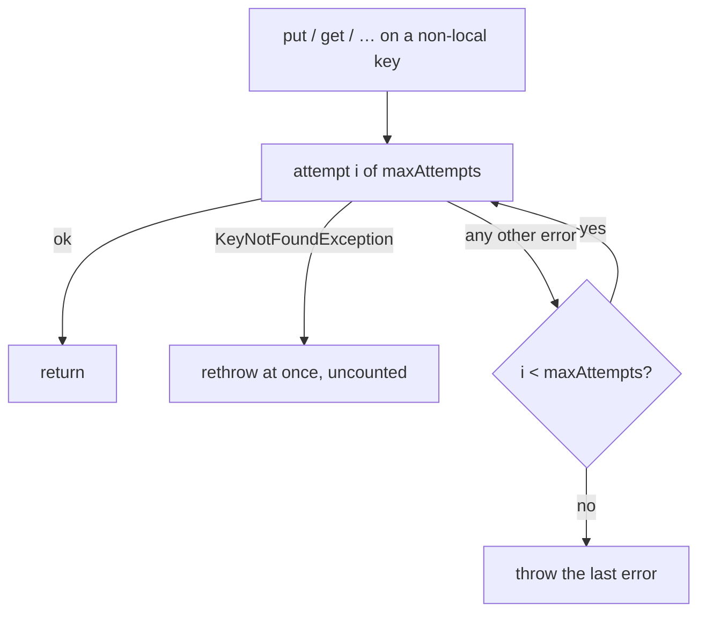

- Bounded and in-memory, not a persistent queue.
- `KeyNotFoundException` bypasses retry entirely. **A miss is normal control flow, not a failure worth retrying.**
- A real `llookup` miss does arrive as `KeyNotFoundException`. The commit traces it through `AtLookupImpl._errorResponseHandler` → `AtExceptionUtils.get`, error code `AT0015`.

#### `local:` keys stay in the session

`local:` keys are client-only by construction. The monitor's `lastreceivednotification` watermark is one. Sending it to the atServer would be wrong, so a separate commit (`e61199c9b`) keeps them in memory.

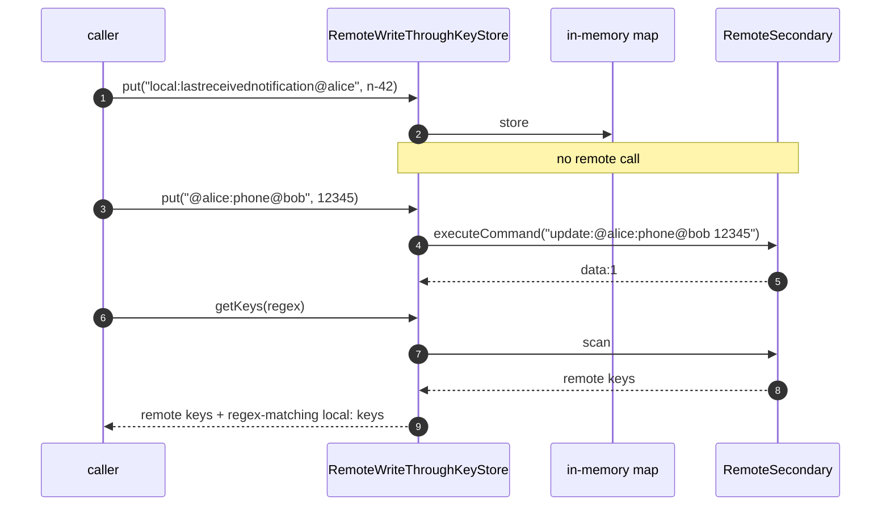

| Rule | Detail |
|---|---|
| Prefix match | `key.toLowerCase().startsWith('local:')`, so `LOCAL:` matches too |
| Absent key | `get` throws `KeyNotFoundException('<key> does not exist in keystore')`, as Hive does |
| `putMeta` | Replaces the metadata of an existing local value |
| `getKeys` | Merges regex-matching local keys into the remote scan result |

#### Design choice

| Option | Chosen | Why |
|---|---|---|
| Persistent retry queue | ✗ | The commit rules it out: "bounded and in-memory, not a persistent queue" |
| Bounded in-memory retry, `maxAttempts` default 3 | ✓ | The write is acknowledged only after the server accepts it, so nothing is left to redeliver |
| Send `local:` keys to the atServer | ✗ | They are client-only by construction |
| Hold `local:` keys in memory for the session | ✓ | Matches their meaning. They are gone when the session ends |

#### Tests

25 tests added in `test/storage/remote_write_through_keystore_test.dart`, all against a `MockRemoteSecondary`.

| Group | Tests | What it checks |
|---|---|---|
| `put` | 1 | Exact string `update:@alice:phone@bob 12345`; returns `null` |
| `putMeta / putAll` | 2 | `update:meta:<key>` then fragment (`:ttl:60000`, `:isBinary:true`); `update:ttl:60000` before `:<key> <data>` |
| `remove` | 1 | `delete:@alice:phone@bob` |
| `get / getMeta` | 4 | `operation == 'all'` and decode; metadata half; `privatekey:at_pkam_privatekey` and `public:publickey@alice` round-trip to their exact wire strings |
| `getKeys` | 1 | `ScanVerbBuilder` with `regex` and `auth: true`; list decode |
| `retry` | 3 | Succeeds on the 3rd call; stops at exactly 3 and rethrows; `KeyNotFoundException` after 1 call |
| `unsupported members` | 1 | 14 members throw `UnsupportedError` |
| safe defaults | 5 | Expiry probes `null`, `changes` empty, hooks empty, capability flags `false`, `commitLog` `null` |
| `local:` keys | 7 | Round-trip, metadata, `putMeta`, absent-key miss, `remove`, case-insensitive prefix, `getKeys` merge; `tearDown` asserts `executeCommand` was never called |

---

### 2c — `RemoteOnlyAtClientStorage`

#### Why

- D-18's amendment: remote-only ships as `RemoteOnlyAtClientStorage implements AtClientStorage`. **One gateway, not two.**
- D-17 "V1 ships remote-only; the local store is a bundle choice, not a removed capability" makes this bundle the browser default. It still needs a concrete class for `buildAtClient` to receive.

#### What

`RemoteOnlyAtClientStorage extends AtClientStorageBase`, constructed with `atSign`, `remoteSecondary`, `keyStoreMaxAttempts` (default 3) and `closedByClient`.

| Member | Behaviour |
|---|---|
| `location` | `'remote:$atSign'` |
| `openBackend` | Builds a `RemoteWriteThroughKeyStore` and an `AtSyncQueue` opened on `const NoopSyncQueueStore()`. Idempotent: returns early if already open |
| `keyStore` / `syncQueue` | `StateError('storage for <atSign> is not open')` before `openBackend` |
| `closeBackend` | Closes the queue only. The injected `RemoteSecondary` is the caller's to close |
| `clearData` | `UnsupportedError('RemoteOnlyAtClientStorage.clearData: clearing a live atServer is a destructive remote operation, not implemented in this slice')` |

`lib/remote_only.dart` exports the class. It mirrors `lib/sqlite.dart`, so consumers don't need an `implementation_imports` reach into `src/`. The test file imports through it.

#### Design choice — what `location` is keyed by

| Option | Chosen | Why |
|---|---|---|
| Per (atSign, enrollmentId) | ✗ | D-14 "The storage-isolation design": production stays atSign-keyed; `enrollmentId` is a test-fixture discriminator only |
| Per atSign: `remote:<atSign>` | ✓ | A second storage over the same atSign is the same store. `AtClientStorageBase.attach` refuses it with `StateError('another storage is already open at remote:<atSign>…')` rather than sharing silently |

#### Tests

6 tests added in `test/storage/remote_only_at_client_storage_test.dart`.

| Test | What it checks |
|---|---|
| attach, put, get | Reads and writes reach the mocked `RemoteSecondary`: `executeCommand` ×1, `executeVerb` ×1 (X-R1; X-R2 wiring only) |
| `syncQueue` | Open and empty after attach |
| `location` | Differs across atSigns; a second storage for the same atSign throws `StateError` on `attach` |
| `clearData` | `storage.clear()` throws `UnsupportedError` |
| `closeBackend` | `remoteSecondary.closeConnection()` is never called |
| `buildAtClient` | Constructs under `isLocalStoreRequired: false` with `llookup` throwing `KeyNotFoundException` (no key material); `client.localSecondary` is not null |

---

### Verification

| Branch | Tests added | at_client suite | Source |
|---|---|---|---|
| 2a | 5 | — | diff |
| 2b | 25 | — | diff; PR body says "25 unit tests" |
| 2c | 6 | 2139 / 2139 | diff; suite figure from the #2260 PR body |

- Across 2a–2c: 7 files changed, +979 / −0, all in `packages/at_client`.
- No `CHANGELOG.md` change in any of the three.

---

### Open items

| Item | Status | Where |
|---|---|---|
| `get` on the remote path decodes with `AtData().fromJson` and doesn't stamp `AtData.key`. On a live client this threw a `TypeError` in `GetResponseTransformer` | Fixed later | 6b, [#2274](https://github.com/atsign-foundation/at_client_sdk/pull/2274); see [Stage 6](#stage-6) §4 |
| A remote-only client still ran the default sync loop | Fixed later with `WriteThroughSyncService` | 6c, [#2275](https://github.com/atsign-foundation/at_client_sdk/pull/2275) |
| `remote_only.dart` had no WASM gate | Gated later: 0 offenders, compiles | 6a, [#2273](https://github.com/atsign-foundation/at_client_sdk/pull/2273) |
| The 2c test covers X-R2 composition wiring only, not two clients reading each other's writes | Closed later by the X-R2 interop test | 6d, [#2276](https://github.com/atsign-foundation/at_client_sdk/pull/2276) |
| The code comment and test on `location` cite "D-13" for atSign-only keying. D-13 is "Local storage is isolated per (atSign, enrollmentId), not per atSign"; the atSign-keyed production rule is D-14 "The storage-isolation design" | Open | `remote_only_at_client_storage.dart`, `remote_only_at_client_storage_test.dart` |
| `clearData` against a live atServer | Out of scope for this slice | `RemoteOnlyAtClientStorage.clearData` |
| `local:` keys are lost when the session ends, including the `lastreceivednotification` watermark | Not addressed in stage2 | `RemoteWriteThroughKeyStore` |

---

<a id="stage-3"></a>

## Stage 3 — a remote-only client must be handed its keys

**Bottom line:**
- A client on `RemoteOnlyAtClientStorage` with neither `atChops:` nor `atKeysIo:` now fails at construction with a `StateError`.
- Before this, it constructed **silently with an empty keypair**, and authenticated and decrypted nothing.
- The storage declares the fact itself: new `AtClientStorage.holdsKeyMaterial`, `false` only for `RemoteOnlyAtClientStorage`.
- A fresh ephemeral session (enroll → approve → client) already hands the client an in-memory `AtKeysIo`, so it opens on remote-only storage unchanged. A new test proves it.


---

### Where this sits in PB-3

- **R3** is item e/R3 of the PB-3 plan. It has two halves.
- **Half 1, the hoist,** shipped in stage1 (#2257). `_atChops ??= await _createAtChops(_atSign)` and `_validateDefaultCryptoProvider()` now run outside the `isLocalStoreRequired` branch.
- **Half 2, the precondition,** is this PR: a remote-only client takes its key material as a named precondition.

| "R3" in these docs | Means | Same thing? |
|---|---|---|
| PB-3 e/R3 | Key material is a precondition of a remote-only client | This doc |
| `implementation-plan.md` R3 | The no-throwing-stub gate | ✗ Unrelated |
| `acceptance.md` §9a.2 X-R3 | A write is not acknowledged until the atServer accepts it | ✗ Unrelated |

---

### Why

D-18 consequence 3, quoted from `decisions.md`:

> **`AtChops` must not be rebuilt from a store that never held the keys.** … A remote-only bundle has no durable keystore at all, so key material must come from `AtKeysIo` and must never be inferred from storage.

The atServer never holds a client's private keys. **A `RemoteOnlyAtClientStorage` is therefore never a valid key source,** and the client must say so rather than guess.

---

### What

#### The problem

With `RemoteOnlyAtClientStorage`, no `atChops:` and no `atKeysIo:`, `_createAtChops` fell through to its store path.

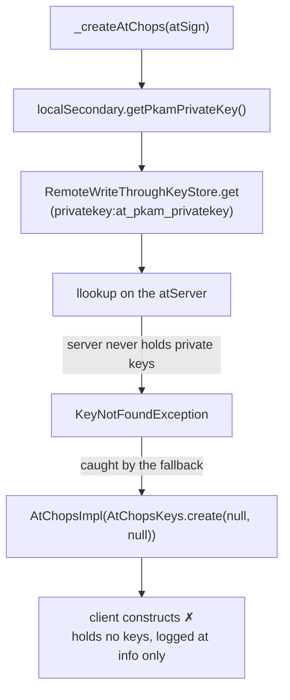

- The lookup ran on a connection that needs those very keys to authenticate.
- The fallback catches `KeyNotFoundException` on purpose. For a local store, "no keys" is the ordinary state before onboarding.
- The only signal was an `info` log: "…'s local store holds no key material, so this client holds none…".

#### Root cause

**The store fallback could not tell "not onboarded yet" from "this backend can never hold keys".** Both surfaced as the same `KeyNotFoundException`.

#### Design choice: a capability flag

| Option | Verdict |
|---|---|
| `_storage is RemoteOnlyAtClientStorage` in `AtClientImpl` | ✗ Couples `at_client_impl.dart` to one concrete backend |
| Key off `!isLocalStoreRequired` | ✗ Breaks stage1's valid case: a pre-seeded non-Hive store with no `AtKeysIo` |
| **`AtClientStorage.holdsKeyMaterial`** | ✓ The storage declares its own capability, and the client asks |

#### The change

| File | Change |
|---|---|
| `lib/src/storage/at_client_storage.dart` | New abstract `bool get holdsKeyMaterial` on `AtClientStorage`. `AtClientStorageBase` returns `true` |
| `lib/src/storage/remote_only_at_client_storage.dart` | Overrides `holdsKeyMaterial` → `false` |
| `lib/src/client/at_client_impl.dart` | `_createAtChops` throws `StateError` when `_storage?.holdsKeyMaterial == false`, placed after the `_atKeysIo` branch |

The error text:

```
<atSign>'s storage holds no key material, so this client has no keys to
authenticate or decrypt with. Pass atKeysIo: (or atChops:) when creating it.
```

#### The decision flow after stage3

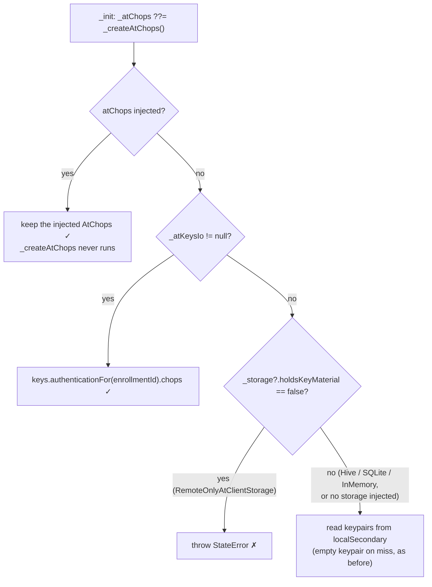

#### Why the guard's placement is enough

- **Injected `atChops`:** `_init` uses `??=`, so `_createAtChops` never runs.
- **Re-derive after enrollment:** `_rederiveFromEnrollment` is called only from `_settleEnrollmentIdentity`, which returns early when `_atKeysIo == null`. So a re-derive always takes the `AtKeysIo` branch.
- **No storage injected:** `_storage` is `null`, the `== false` test fails, and the old fallback runs unchanged.

#### Additive interface member

The PR's grep found no class that implements `AtClientStorage` directly and no mock of it. Every backend extends `AtClientStorageBase`, so the concrete `true` there reaches all of them.

---

### Fresh ephemeral session

#### Why it already works

Enrollment files its keys into the `AtKeysIo` named at submission. `PendingEnrollment.client()` then builds the client over that store. **So the `AtKeysIo` branch is taken, and the new guard is never reached.**

#### The test

`test/lifecycle/enroll_test.dart`, "a fresh ephemeral session enrolls and opens on remote-only storage: its keys come from the enrollment's in-memory store, never the atServer".

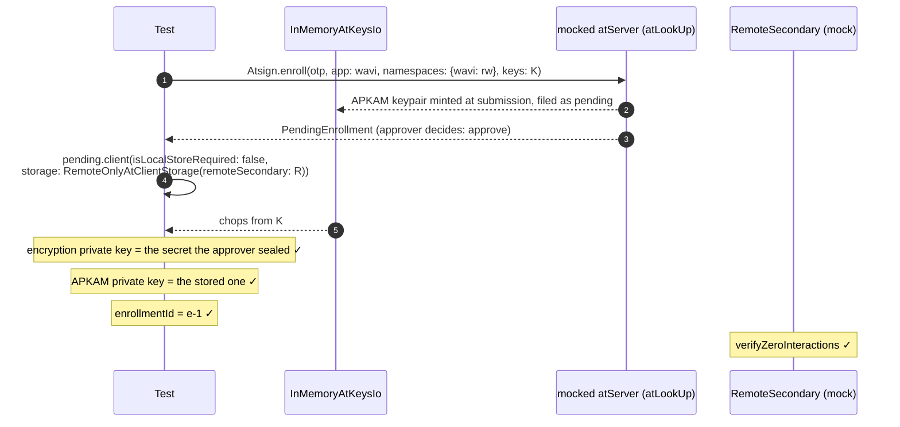

---

### Tests

5 tests added, 1 test changed.

| Test | File | What it checks |
|---|---|---|
| holdsKeyMaterial: false for remote-only, true for a local backend | `test/remote_only_key_precondition_test.dart` | `RemoteOnlyAtClientStorage` → `false`; `InMemoryAtClientStorage` → `true` |
| no atChops and no atKeysIo: construction throws StateError and never asks the server for key material | same | `StateError` whose message contains `atKeysIo`; `verifyNever(remote.executeVerb)` |
| atKeysIo: constructs, chops come from AtKeysIo | same | PKAM public key matches the `InMemoryAtKeysIo.holding` keys; no `executeVerb` |
| injected atChops: constructs and keeps the injected instance | same | `identical(client.atChops, chops)`; no `executeVerb` |
| a fresh ephemeral session enrolls and opens on remote-only storage… | `test/lifecycle/enroll_test.dart` | See §4 |
| *(changed)* a RemoteOnlyAtClientStorage constructs via buildAtClient… | `test/storage/remote_only_at_client_storage_test.dart` | Now passes `atKeysIo: InMemoryAtKeysIo.holding(...)`. The stub that made `executeVerb` throw `KeyNotFoundException`, which fed the empty-keypair fallback, is removed |

- The precondition tests' `setUp` makes `executeVerb` throw `KeyNotFoundException`, the same server miss the write-through keystore surfaces. So a regression back to the fallback would be caught by `verifyNever`, not masked.
- **Regression guard for the rejected option:** stage1's "chops resolves through a pre-seeded non-Hive keystore when no AtKeysIo is injected" (`test/at_client_mode_e_construction_test.dart`) is unchanged by this PR. It is the case that keying off `!isLocalStoreRequired` would have broken.

---

### Verification

| Item | State |
|---|---|
| Commits | `70f1b25ab` feat (lib + precondition tests + the stage2c test change), `11a1ece4e` test (enroll) |
| Diff | 6 files changed, +187 / −4 |
| `CHANGELOG.md` | No entry in this PR |
| AI attribution trailers | None on either commit |

---

### Open items

| Item | Owner | Blocks |
|---|---|---|
| A `CHANGELOG.md` entry for the new `StateError` and the `holdsKeyMaterial` member | PB-3 | Nothing. Construction now fails where it used to succeed with no keys, so consumers may want it called out |
| Mode P: the sealed IndexedDB `AtKeysIo` as the browser's key source | Browser lane | Nothing here. This PR only requires *some* `AtKeysIo` or `AtChops` |

---

<a id="stage-4"></a>

## Stage 4 — Hive leaves the default barrel

**Bottom line:**
- `package:at_client/at_client.dart` no longer exports `HiveAtClientStorage`. It now comes from `package:at_client/hive.dart`.
- On the web branch of the import graph, `package:hive` is unreachable from `at_client.dart`, `remote_only.dart` and `sqlite.dart`.
- On native, a client built with no `storage:` still gets Hive under `hiveStoragePath`, as before.
- On the web, a client that would have fallen back to Hive throws a `StateError` that points at `storage:` instead.
- `AtClientStorage` gains an abstract `persistenceBundle` getter, which is also **BREAKING** for a direct implementer.
- Consumers add one import line. `at_client_flutter.dart` re-exports `hive.dart`, so apps importing it change nothing.


---

### Why

D-17 "V1 **ships** remote-only; the local store is a bundle choice, not a removed capability" fixes the browser payload: "no SQLite, no VFS, no `sqlite3.wasm`, no Hive in the shipped browser payload".

**Before stage4, every importer of `at_client.dart` paid for Hive, whatever storage it injected.** Three edges carried it:

| Edge (stage3) | Why it drags Hive in |
|---|---|
| `at_client.dart` exports `src/storage/hive_at_client_storage.dart` | That file imports `package:at_persistence_secondary_server/hive.dart` |
| `src/sync/at_sync_queue.dart` imports `package:hive/hive.dart` and `at_persistence_secondary_server/hive.dart` | The queue's fallback opened a Hive box itself |
| `src/sync/sync_queue_store.dart` imports `package:hive/hive.dart` | `HiveBoxSyncQueueStore` lived next to the neutral `SyncQueueStore` interface |

- `at_client_factory.dart` and `at_client_impl.dart` also imported `hive_at_client_storage.dart` directly, for the default, the location check and `persistenceBundle`.
- Hive is not only a payload cost. In `at_persistence_secondary_server` 5.3.0 (the resolved version), `hive_instances.dart`, `hive_base.dart` and `hive_at_keyvalue_store.dart` import `dart:io`. A browser build cannot use that code.

Stage5 (#2263), stacked on this, removes the remaining `dart:io` from `at_client.dart` and gates it in CI.

---

### What

#### Barrels, before and after

| Barrel | stage3 | stage4 |
|---|---|---|
| `package:at_client/at_client.dart` | Exports `HiveAtClientStorage` | Does not export it |
| `package:at_client/hive.dart` | — | **New.** Exports `src/storage/hive_at_client_storage.dart` |
| `package:at_client/remote_only.dart` | Unchanged | Unchanged |
| `package:at_client/sqlite.dart` | Unchanged | Unchanged |
| `package:at_client_flutter/at_client_flutter.dart` | Re-exports `at_client.dart` | Also re-exports `at_client/hive.dart` |

#### Export and import edges

Edges are labelled `export` or `import`. `FAC` and `IMPL` are reached from `at_client.dart` through its other exports.

Before (stage3):

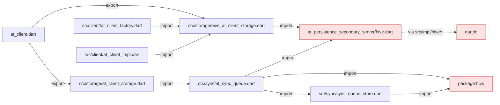

After (stage4):

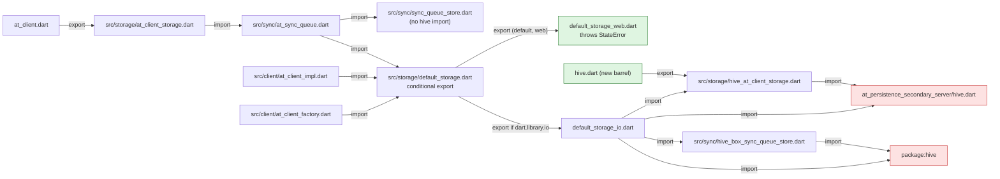

- After stage4, `lib/src` imports `hive_at_client_storage.dart` in only two places: `hive.dart` and `default_storage_io.dart`.

#### The default-storage seam

`src/storage/default_storage.dart` is two lines: `export 'default_storage_web.dart' if (dart.library.io) 'default_storage_io.dart';`. Both branches expose the same four functions.

| Function | Caller | `_io` branch | `_web` branch |
|---|---|---|---|
| `defaultAtClientStorage` | `AtClientImpl._init`, when no `storage:` is injected, `isLocalStoreRequired` is true and `hiveStoragePath` is set | `HiveAtClientStorage(atSign, storagePath, closedByClient)` | Throws `StateError` |
| `defaultStorageLocation` | factory `_locationOf` | `HiveAtClientStorage(...).location` | `null` |
| `isDefaultStorage` | factory's `isLocalStoreRequired` check | `storage is HiveAtClientStorage` | `false` |
| `defaultSyncQueueStore` | `AtSyncQueue.open`, when no `store:` is passed | `HiveBoxSyncQueueStore` on `HiveInstances.forPath(path)`, or the global `Hive` when the path is null | Throws `StateError` |

- `_init` still throws `Exception('Please set local storage path')` first when `hiveStoragePath` is null. A client with no `storage:` and `isLocalStoreRequired: false` reaches neither branch.
- The web `StateError` message: "There is no default storage on the web; pass storage: (e.g. RemoteOnlyAtClientStorage)".

#### Other changes

| File | Change |
|---|---|
| `src/sync/hive_box_sync_queue_store.dart` (new) | `HiveBoxSyncQueueStore` moves here from `sync_queue_store.dart` |
| `src/sync/at_sync_queue.dart` | `open` drops the `injectedBox` test seam; it takes `store ?? await defaultSyncQueueStore(...)` |
| `src/storage/at_client_storage.dart` | New capability `AtPersistenceBundle? get persistenceBundle`; `AtClientStorageBase` returns `null` |
| `src/storage/hive_at_client_storage.dart` | Its `bundle` getter becomes the `persistenceBundle` override |
| `src/client/at_client_impl.dart` | `persistenceBundle => _storage?.persistenceBundle`, replacing a `storage is HiveAtClientStorage` check |
| `README.md` | Names `package:at_client/hive.dart` as where `HiveAtClientStorage` comes from |

---

### Migration

A consumer that names `HiveAtClientStorage` adds one import:

```dart
// before
import 'package:at_client/at_client.dart';

// after
import 'package:at_client/at_client.dart';
import 'package:at_client/hive.dart';
```

| Consumer | Action |
|---|---|
| Dart app or CLI that constructs `HiveAtClientStorage` | Add `import 'package:at_client/hive.dart';` |
| Native app that passes no `storage:` | Nothing. The default is still Hive under `hiveStoragePath` |
| App importing `at_client_flutter.dart` | Nothing. It re-exports `hive.dart` |
| Browser app that passes no `storage:` | Pass one, e.g. `RemoteOnlyAtClientStorage` from `package:at_client/remote_only.dart`. Otherwise `StateError` |
| Code calling `HiveAtClientStorage.bundle` | Use `persistenceBundle` |
| A class that `implements AtClientStorage` directly | Implement `AtPersistenceBundle? get persistenceBundle`, or extend `AtClientStorageBase`, which returns `null` |
| Test code calling `AtSyncQueue.open(injectedBox: box)` | Use `open(store: HiveBoxSyncQueueStore(box))`, importing `src/sync/hive_box_sync_queue_store.dart` |

#### Swept in this PR

| Package | Files that gained `import 'package:at_client/hive.dart'` |
|---|---|
| `at_client` tests | `at_client_create_test.dart`, `at_client_manager_principal_change_test.dart`, `process_exit/busy_client.dart`, `storage/at_client_storage_release_test.dart`, `storage/at_client_storage_wiring_test.dart`; `storage/hive_at_client_storage_test.dart` swaps its import |
| `at_onboarding_cli` | `lib/src/util/at_onboarding_preference.dart`, `example/util/atsign_preference.dart`, `test/at_onboarding_storage_test.dart` |
| `at_contact` | `test/test_util.dart` |
| `at_end2end_test` | `lib/src/test_preferences.dart`, `test/notify_with_isolate_test.dart` |
| `at_functional_test` | `lib/src/functional_storage.dart`, `test/sync_multiple_client_test.dart` |
| `at_client_skills` | `SKILL.md` and `01-deprecation-guide.md` name the import in the `hiveStoragePath` migration row; the `14-multi-agent.md` and `15-client-lifecycle.md` snippets gain the import |

---

### Design choices

#### Where Hive goes: a separate barrel plus an internal conditional default

| Option | Verdict |
|---|---|
| Keep Hive in `at_client.dart` | ✗ Every browser importer ships Hive, against D-17 "V1 **ships** remote-only; the local store is a bundle choice, not a removed capability" |
| Require `storage:` everywhere, no default (pure injection, per D-1 "Injection over conditional imports") | ✗ Breaks every native caller that relies on the `hiveStoragePath` default. The PR keeps that behaviour on native |
| **`hive.dart` barrel for the public type, and a conditional `default_storage.dart` for the internal default** | ✓ Follows the `remote_only.dart` / `sqlite.dart` pattern. Native behaviour is unchanged, and the web branch never reaches Hive |

- This choice sits against D-1 "Injection over conditional imports" and D-2 "No throwing stubs". The web branch is a throwing stub. §7 lists it as open.
- The 2026-09-14 amendment to D-1 "Injection over conditional imports" asks that a conditional in a gated package have both branches walked: the web branch by the ratchet and the native branch by a control.
- `at_client` has no stanza in `.github/wasm_gates.yaml` at stage4, so that audit does not apply yet. The PR's own walk covered the web branch plus two controls (§6). It reports no walk of `default_storage_io.dart` itself.

#### `persistenceBundle`: a capability, not a type check

| Option | Verdict |
|---|---|
| `storage is HiveAtClientStorage ? storage.bundle : null` in `AtClientImpl` | ✗ Forces `at_client_impl.dart` to import the Hive class |
| **`AtClientStorage.persistenceBundle`** | ✓ Follows the precedent of `holdsKeyMaterial`: the storage declares what it has, and callers ask |

#### `isDefaultStorage` on the web: accepted semantic change

- On the web, `isDefaultStorage` is always `false`. So an explicitly passed `HiveAtClientStorage` with `isLocalStoreRequired: false` is no longer refused there.
- The PR accepts this. A capability getter can replace the check if the refusal turns out to matter.

---

### Tests

`test/storage/default_storage_test.dart` (new, 112 lines) imports both branches directly (`as io`, `as web`), so the web branch runs on the VM.

| Group | What it checks |
|---|---|
| `web branch` | `defaultAtClientStorage` and `defaultSyncQueueStore` throw a `StateError` naming `storage:`; `defaultStorageLocation` is `null`; `isDefaultStorage` is `false`, even for a `HiveAtClientStorage` |
| `io branch` | `defaultAtClientStorage` is a `HiveAtClientStorage` on the path with `closedByClient` kept; `defaultStorageLocation` equals the Hive `location`; `isDefaultStorage` is true only for Hive; `defaultSyncQueueStore` persists a record across a reopen on one path |
| `persistenceBundle` | `null` for `RemoteOnlyAtClientStorage` and `InMemoryAtClientStorage`; for Hive, `null` before attach, and after `AtClientImpl.create` the client's `persistenceBundle` is the same object as the storage's |

Other test edits:

| File | Change |
|---|---|
| `public_api_surface_test.dart` | The `at_client.dart` export golden drops `hive_at_client_storage.dart` |
| `sync_stop_abandons_test.dart` | The one `injectedBox:` caller now passes `store: HiveBoxSyncQueueStore(box)` |

---

### Verification

As reported in the PR description:

| Check | Result |
|---|---|
| `at_client` suite | 2154 / 2154 |
| `dart analyze` | Clean on `at_client`, `at_onboarding_cli`, `at_contact`, `at_end2end_test`, `at_functional_test` |
| `flutter analyze` | Clean on `at_client_flutter` |
| Web-branch import walk | No `hive` from `at_client.dart`, `remote_only.dart` or `sqlite.dart` |
| Controls | `hive.dart` still reaches `hive`; `at_client.dart` reaches `default_storage_web.dart` and never `_io` |

- `.github/wasm_gates.yaml` has no `at_client` stanza at stage4; the gate arrives in stage5.
- Ripple check (run for this doc): at stage4, the only `implements AtClientStorage` in `lib/` is `AtClientStorageBase`, so no workspace class misses `persistenceBundle`.
- Diff: 35 files, +247 / −56, in two commits: `4bbcda0dc` (code) and `dedd2ed03` (`at_client_skills` docs).
- `CHANGELOG.md` is not touched in this PR. The PB-3 changelog entry for `hive.dart` lands later, in `7a467ebc4`.

---

### Open items

| Item | Owner | Blocks |
|---|---|---|
| The web branch of `default_storage.dart` is a throwing stub, against D-2 "No throwing stubs", and the seam is a conditional export, against D-1 "Injection over conditional imports" | No ruling in `decisions.md` covers it. T0.4 "no throwing fallbacks" is not implemented, so D-2 "No throwing stubs" is upheld by review only. Needs an amendment to D-1 "Injection over conditional imports" and D-2 "No throwing stubs", or a follow-up that replaces the stub | Nothing at runtime. A browser app that passes `storage:` never reaches it |
| The direct `hive: ^2.2.3` dependency stays in `at_client`'s pubspec (plan item I10 "Drop the direct `hive: ^2.2.3` dependency") | Not assigned in this PR | Nothing on the web branch. It is still resolved on native through `default_storage_io.dart` |
| `isDefaultStorage` is `false` on the web, so the Hive refusal under `isLocalStoreRequired: false` no longer applies there | Whoever needs the refusal back; a capability getter replaces it | Nothing today |

---

<a id="stage-5"></a>

## Stage 5 — no `dart:io` in `at_client.dart`, file/stream API removed, CI gate

**Bottom line:**
- **BREAKING:** the deprecated file-transfer and stream API is **deleted, not moved**. The SDK has no replacement for it.
- No source file in `at_client` imports `dart:io` any more when reached from `package:at_client/at_client.dart`. `FileAtKeysIo` and `secureSocketLookUps` move to a new barrel, `package:at_client/at_client_io.dart`.
- A new `at_client:` stanza in `.github/wasm_gates.yaml` holds that line: 0 offenders, and 3 blocked packages inherited from `at_lookup`, `at_utils` and `chalkdart`.
- `archive`, `http` and `internet_connection_checker` leave `at_client`'s `pubspec.yaml`.


---

### Why

PB-3 is the `at_client` part of browser support. The goal is a client that runs in the browser with no disk and no `dart:io`.

- Before stage5, 7 of `at_client`'s own files imported `dart:io`. 5 were the file/stream API (`at_client_spec.dart`, `at_client_impl.dart`, `encryption_service.dart`, `file_transfer_service.dart`, `stream_notification_handler.dart`); `List<File>` sat in `AtClient`'s public signatures.
- The other 2 were `remote_secondary.dart` (for `isAvailable`) and `at_connection.dart` (for socket-error classification, §3).
- D-3 "Breaking majors are accepted" already names this break: "`dart:io File` leaves the `AtClient` public surface".
- Every removed member was already `@Deprecated`. Their messages said the file methods were "moved to app layer" and the stream methods were "Obsolete, will be removed in v4".
- So deleting was cheaper than porting. OQ-4 "File transfer: change the API, or extract the component?" offered both; this PR takes neither and removes the API.
- The PR also removes the last `at_client` caller of `getSocket()` (`RemoteSecondary.addStreamData`). That unblocks at_lookup T3 (#2223).

---

### What was removed

| API | Replacement |
|---|---|
| `AtClient.uploadFile` / `downloadFile` / `reuploadFiles` / `shareFiles` | none — file transfer belongs to the app |
| `AtClient.stream` / `sendStreamAck` | none |
| `EncryptionService.encryptFileInChunks` / `decryptFileInChunks` | none (`generateFileEncryptionKey` stays) |
| `FileTransferService` (`file_transfer_service.dart`) | none |
| `src/stream/*`: `AtStreamNotification`, `AtStreamResponse`, `FileTransferObject`, `FileStatus`, `FileDownloadResponse`, `StreamNotificationHandler` | none |
| `ConnectivityListener` | none — its deprecation said to use "a connectivity checker of your own choice" |
| `RemoteSecondary.isAvailable` | none |
| `RemoteSecondary.addStreamData` | none |

| Dependency | Why it could go |
|---|---|
| `archive` | only `FileTransferService` used it |
| `http` | only `FileTransferService` used it |
| `internet_connection_checker` | only `ConnectivityListener` and `RemoteSecondary.isAvailable` used it |

Across the whole PR: 67 files changed, +110 / −927.

---

### The io split

**`at_client.dart` stops exporting the two `dart:io` helpers, and a new `at_client_io.dart` exports only them.**

```dart
// packages/at_client/lib/at_client_io.dart
export 'package:at_auth/at_auth_io.dart' show FileAtKeysIo;
export 'package:at_lookup/at_lookup_io.dart' show secureSocketLookUps;
```

`at_client_io.dart` does **not** re-export `at_client.dart`. A `dart:io` app imports both.

#### The one `dart:io` use left in `at_client`'s own code

`classifyConnectionFailure` in `at_connection.dart` checked `SocketException` and `HandshakeException`. That check now goes through `isTransportError`, behind a conditional export:

| File | Body |
|---|---|
| `transport_error.dart` | `export 'transport_error_web.dart' if (dart.library.io) 'transport_error_io.dart';` |
| `transport_error_io.dart` | `error is SocketException \|\| error is HandshakeException` |
| `transport_error_web.dart` | `false` |

- The web branch returns `false` because web transport errors arrive as at_lookup exceptions, and those are already classified.
- This is the same pattern as stage4's `default_storage.dart`.

#### Barrels after stage5

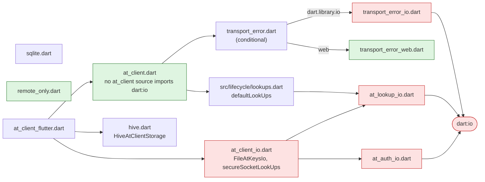

- **Red** reaches `dart:io` directly. **Green** is what a browser build resolves.
- `lookups.dart` → `at_lookup_io.dart` is the one path from `at_client.dart` to `dart:io` that remains. It is inherited from `at_lookup`, not owned by `at_client`, and stays until PB-2.
- `at_client_flutter` re-exports `at_client_io.dart`, so Flutter apps see no change.

---

### The CI gate

#### Why a compile is not enough

**`dart compile wasm` does not reject `dart:io`.** It ships a stub that throws `Unsupported operation` at first use. That is why D-6 "The structural gate is primary; the compiler is not a gate" puts the import-graph walk above the compile.

`tools/wasm_shakedown` runs three checks per gated package:

| Key | What it does | Catches |
|---|---|---|
| `ratchets` | Walks the import graph from a barrel, resolving conditional imports as the web does | `dart:io`, and anything else forbidden, reachable from the barrel |
| `probe` | Runs `dart compile wasm` on a generated `void main() {}` that imports the barrel | Libraries dart2wasm rejects outright (`dart:html`, `dart:js`, `dart:ffi`, `dart:mirrors`) |
| `controls` | Walks the other side of a platform seam and asserts it still **reaches** a known file or library | A ratchet that has quietly stopped proving anything |

- **Offenders** are the gated package's own sources that reach a forbidden library. **Blocked packages** are all packages anywhere in the graph that own one.
- Both baselines are one-way. A new offender, or a count above the ceiling, fails. A fix passes with no edit.
- `min_files_walked` catches a stalled walk, which would otherwise find 0 offenders and pass.
- Controls resolve with io semantics by default. `environment: web` pins the other branch.

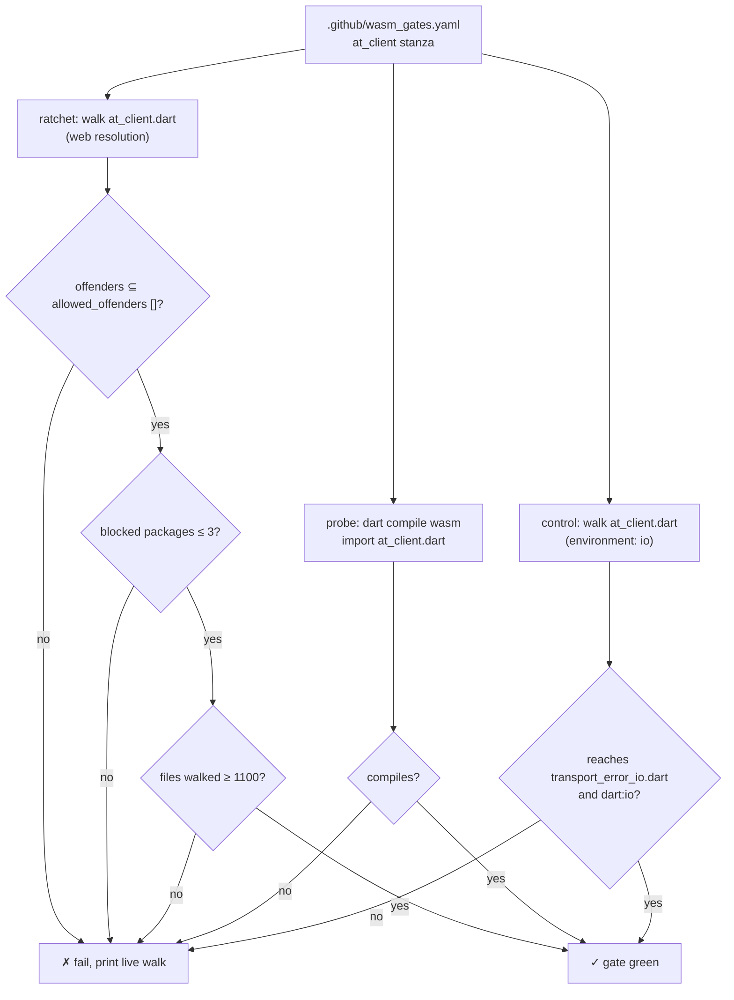

#### The stanza added

```yaml
at_client:
  # Gated since PB-3 stage5; at_client.dart holds no dart:io. The three
  # blocked packages are inherited: at_lookup via lib/src/lifecycle/lookups.dart
  # (defaultLookUps, until PB-2), at_utils and chalkdart via the logger. Hive
  # and SQLite sit behind hive.dart / sqlite.dart and a conditional default.
  ratchets:
    - barrel: package:at_client/at_client.dart
      allowed_offenders: []
      max_blocked_packages: 3
      min_files_walked: 1100
  probe:
    - package:at_client/at_client.dart
  controls:
    - barrel: package:at_client/at_client.dart
      environment: io
      reaches_file: lib/src/lifecycle/transport_error_io.dart
      reaches_library: dart:io
      because: the socket-error classification the web branch stubs
```

- **Why this control:** controls only count files the gated package owns. Hive lives in package `hive`, and `at_client_io.dart` only re-exports other packages, so neither can serve. `transport_error_io.dart` is `at_client`'s own file on the io side of a seam.
- The yaml header comment drops `at_client` from its list of ungated packages.

#### Measured (from the PR body)

| | Files walked | Offenders | Blocked packages |
|---|---|---|---|
| Before stage5 | 1283 | 7 | 8 |
| After stage5 | 1145 | 0 | 3 |

The 3 blocked packages:

| Package | Path into the graph | Owner |
|---|---|---|
| `at_lookup` | `lib/src/lifecycle/lookups.dart` → `at_lookup_io.dart` (`defaultLookUps`) | PB-2 (#2223) |
| `at_utils` | the logger | PB-1 (#2214) |
| `chalkdart` | the logger, via `at_utils` | PB-1 (#2214) |

---

### Migration for consumers

| You use | Do this |
|---|---|
| `FileAtKeysIo` or `secureSocketLookUps` | Add `import 'package:at_client/at_client_io.dart';` next to `at_client.dart` |
| `at_client_flutter` | Nothing. It re-exports `at_client_io.dart` |
| Any API in §2 | Delete the call. Move file transfer or connectivity checks into the app |
| `archive`, `http` or `internet_connection_checker` through `at_client` | Declare it in your own `pubspec.yaml` |

The in-repo consumer sweep added the `at_client_io.dart` import to:

- `at_cli_commons` (`cli_base.dart`)
- `at_onboarding_cli`: lib (`at_onboarding_service_impl.dart`, `at_onboarding_preference.dart`, `create_at_client_cli.dart`), tests and examples
- `at_contact` (`test_util.dart`)
- `tests/at_end2end_test`, `tests/at_functional_test`, `tests/at_onboarding_cli_functional_tests`
- `at_client` tests, the `at_client_skills` snippets, and the `at_client` README

#### CHANGELOG (`at_client` 4.0.0-rc1)

The 4.0.0-rc1 entry is new in this PR. It covers stage4 and stage5 together:

- BREAKING: `HiveAtClientStorage` is imported from `package:at_client/hive.dart`, and `FileAtKeysIo`/`secureSocketLookUps` from `package:at_client/at_client_io.dart`. `at_client_flutter` re-exports both.
- BREAKING: `uploadFile`, `downloadFile`, `reuploadFiles`, `shareFiles`, `stream`, `sendStreamAck`, `ConnectivityListener` and `RemoteSecondary.isAvailable` are removed.
- BREAKING: `HiveAtClientStorage.bundle` is `persistenceBundle`, a member of `AtClientStorage` (stage4).
- feat: on the web, a client built without `storage:` throws a `StateError` naming it (stage4).

---

### Tests

| Test | Change |
|---|---|
| `test/lifecycle/transport_error_test.dart` | **New**, 2 tests. The io branch is true for `SocketException` and `HandshakeException` and false for `StateError`. The web branch is false for all three |
| `test/file_encryption_test.dart` | **Deleted**, 4 tests. It covered `encryptFileInChunks` / `decryptFileInChunks` |
| `test/samples/file_downloader.dart`, `file_uploader.dart`, `monitor/connectivity_test.dart` | **Deleted** with the APIs they exercised |
| `test/public_api_surface_test.dart` | Golden updated: `connectivity_listener.dart`, `at_auth_io.dart` and `at_lookup_io.dart` leave the `at_client.dart` export set |
| `enroll_test.dart`, `local_secondary_test.dart`, `notification_service_test.dart`, `test_utils/mocks.dart` | Import `at_client_io.dart` |

---

### Verification

From the PR body:

| Check | Result |
|---|---|
| `at_client` suite | 2152 / 2152 (2154 − 4 deleted + 2 new) |
| `dart analyze`, every consumer | clean |
| `flutter analyze` | clean |
| `dart run wasm_shakedown` | green on all 3 gated packages (`at_chops`, `at_auth`, `at_client`) |

Commits:

| Commit | Subject |
|---|---|
| `408edbcbd` | feat(at_client)!: PB-3 stage5 — delete the file/stream API; at_client.dart carries no dart:io |
| `e4cbfc99c` | ci(wasm): gate at_client — 0 offenders, 3 inherited blocked packages |
| `7a467ebc4` | docs(at_client): PB-3 changelog — hive.dart, at_client_io.dart, file/stream API removal |

---

### Open items

| Item | Owner | Blocks |
|---|---|---|
| The 3 inherited blocked packages (`at_lookup`, `at_utils`, `chalkdart`) | PB-1 / PB-2 (#2214, #2223) | A fully io-free graph. The gate ratchets at 3 until then |
| `tools/wasm_shakedown/README.md` still says `at_client` owns 7 offenders and lists only `at_chops` and `at_auth` as gated | Whoever next touches the tool | Nothing. The yaml is correct; only the README is stale |
| The CHANGELOG omits `RemoteSecondary.addStreamData` and `EncryptionService.encryptFileInChunks` / `decryptFileInChunks` | This PR, if wanted | Nothing. `RemoteSecondary` is exported from `at_client.dart`, so `addStreamData` was public |
| `at_client_io.dart` exports only the io helpers. D-5 "Native implementations live in `_io` barrels, not new packages" describes each `_io` barrel as "exporting the neutral barrel plus the native implementations" | Your call: amend D-5 or re-export `at_client.dart` | Nothing. Consumers import both barrels today |
| `remote_only.dart` has no gate of its own | Done in stage6a (#2273) | — |

---

<a id="stage-6"></a>

## Stage 6 — remote-only clients: gated, fixed, proven interoperable

**Bottom line:**
- A client on `RemoteOnlyAtClientStorage` ("Mode E") now compiles under dart2wasm and has a CI gate.
- It reads its own keys without crashing, and it no longer runs a sync loop that can only fail.
- It exchanges data with a Hive client through one atServer, in both directions. Acceptance gate **X-R2** now passes.


---

### Where this sits in PB-3

PB-3 is the `at_client` part of browser support. The goal is a client that runs in the browser with no disk and no `dart:io`.

| Stage | PR | What it delivered | Doc |
|---|---|---|---|
| 1 | #2257 | The factory accepts a non-Hive storage when `isLocalStoreRequired: false`, and chops setup always runs | [Stage 1](#stage-1) |
| 2a | #2258 | `NoopSyncQueueStore`: the sync queue keeps nothing on disk | [Stage 2](#stage-2) |
| 2b | #2259 | `RemoteWriteThroughKeyStore`: every write goes straight to the atServer, and `local:` keys stay in the session | [Stage 2](#stage-2) |
| 2c | #2260 | `RemoteOnlyAtClientStorage` bundles the two, exported from `package:at_client/remote_only.dart` | [Stage 2](#stage-2) |
| 3 | #2261 | R3: a remote-only storage demands key material up front, so an ephemeral session can enroll | [Stage 3](#stage-3) |
| 4 | #2262 | **BREAKING:** `HiveAtClientStorage` moves to `package:at_client/hive.dart` | [Stage 4](#stage-4) |
| 5 | #2263 | **BREAKING:** the file/stream API is deleted, `at_client.dart` has no `dart:io`, and CI gates it | [Stage 5](#stage-5) |
| **6a–6d** | **#2273–#2276** | **Remote-only barrel gated, `get` and sync fixed, X-R2 passes** | **This doc** |

---

### The stage6 asks, and what came of them

| Ask | Result | Branch |
|---|---|---|
| "fix the wasm compile thing" | `remote_only.dart` gets its own ratchet and a compile probe. 0 offenders, and it compiles | 6a |
| (found while running X-R2) | `get` on a remote-only client threw a `TypeError`. Fixed | 6b |
| "fix the syncService warning" | A remote-only client gets `WriteThroughSyncService`, and the warning is gone | 6c |
| "perform the x-r2 test" | Two tests, one per direction. Both green | 6d |

**Order is deliberate.** The `get` fix (6b) sits under the sync fix and the test, so each PR is green on its own. 6d depends on both fixes.

---

### 6a — WASM gate for `remote_only.dart`

#### Why

- stage5 gated `package:at_client/at_client.dart` only.
- `remote_only.dart` is the barrel that browser apps will import. If nothing gates it, a new `dart:io` import can slip in unnoticed.
- **dart2wasm does not reject `dart:io` imports.** The compile alone proves nothing, which is why the gate also runs an import-graph walk (the "ratchet").

#### What

The change is in `.github/wasm_gates.yaml`, under `at_client`:

```yaml
    - barrel: package:at_client/remote_only.dart
      allowed_offenders: []
      max_blocked_packages: 3
      min_files_walked: 1050
  probe:
    - package:at_client/at_client.dart
    - package:at_client/remote_only.dart
```

#### Measured

| Barrel | Files walked | Offenders | Blocked packages | dart2wasm compile |
|---|---|---|---|---|
| `at_client.dart` | 1146 | 0 / 0 | 3 / 3 | ok |
| `remote_only.dart` | 1097 | 0 / 0 | 3 / 3 | ok |

- **`min_files_walked`** guards against a false pass. If the walk broke and found 0 files, it would also find 0 offenders.
- **The 3 blocked packages** are `at_lookup`, `at_utils` and `chalkdart`. They are inherited, and PB-1/PB-2 own them (#2214, #2223).

---

### 6b — `get` crashed on remote-only clients

#### Symptom

X-R2 direction 1 failed with:

```
type 'Null' is not a subtype of type 'String'
  in GetResponseTransformer
```

#### Root cause

**`AtData.fromJson` never sets `AtData.key`.** Each keystore stamps the key after reading, but `RemoteWriteThroughKeyStore` skipped that step.

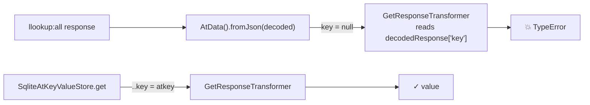

#### Fix

One line in `lib/src/storage/remote_write_through_keystore.dart`. It matches what the SQLite store already does:

```dart
return AtData().fromJson(decoded)..key = key;
```

#### Test (TDD, red first)

`remote_write_through_keystore_test.dart` gains "get stamps the AtData with the key it was read under". It asserts `result?.key == '@alice:phone@bob'`.

#### Why no unit test caught it

The stage2b tests only checked `.data` and `.metaData`. It took a full `AtClient.get` round trip to reach the transformer, and X-R2 was the first test to make one.

---

### 6c — the sync warning

#### Symptom

Every remote-only client logged `Unexpected exception in sync` in a loop.

#### Root cause

The factory always built `SyncServiceImpl`. `SyncServiceImpl` reconciles a **local replica** against the server. A remote-only client has no replica: every write already lands on the server. So sync had nothing to reconcile, and failed each time it tried.

#### Design choice: a capability flag, not a type check

| Option | Verdict |
|---|---|
| `storage is RemoteOnlyAtClientStorage` in the factory | ✗ Couples the factory to one concrete class, and a second write-through backend would need another branch |
| **`AtClientStorage.replicatesServer`** | ✓ Follows the precedent of `holdsKeyMaterial`: the storage declares what it can do, and callers ask |

#### What

| File | Change |
|---|---|
| `at_client_storage.dart` | New abstract `bool get replicatesServer`, with `AtClientStorageBase` returning `true` |
| `remote_only_at_client_storage.dart` | `replicatesServer => false` |
| `write_through_sync_service.dart` (new) | `WriteThroughSyncService` plus the `defaultSyncServiceFor` chooser |
| `at_client_factory.dart`, `at_client_manager.dart` | Both call `defaultSyncServiceFor(...)`. There is one chooser, not two |

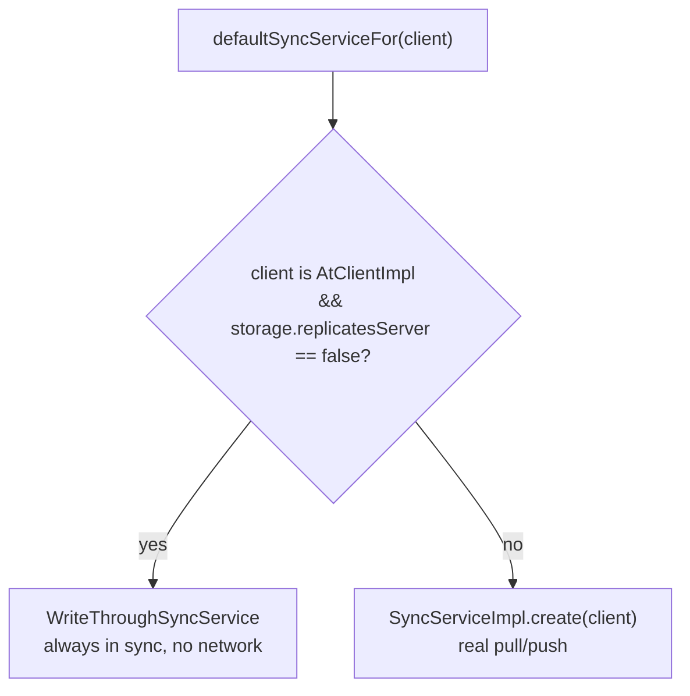

#### How `WriteThroughSyncService` behaves

| Member | Behavior |
|---|---|
| `isInSync` | `true` |
| `isSyncInProgress` | `false` |
| `sync(onDone:)` | Emits success in a **microtask**: a `SyncProgress` with `pendingPushCount: 0` to listeners, then a `SyncResult(success, dataChange: false)` to `onDone` |
| `waitUntilCaughtUp` | Completes at once. The base implementation already treats a success with null commit ids as "caught up" |
| listeners | `add`, `remove` and `removeAllProgressListeners` work on a plain set |

- **Why a microtask:** callers register listeners after calling `sync()`. If the result were emitted synchronously, those listeners would miss it.

#### Tests

| Test | What it checks |
|---|---|
| `write_through_sync_service_test.dart` | 4 tests: in sync / not in progress, success reaches both `onDone` and listeners, a removed listener hears nothing, `waitUntilCaughtUp` completes |
| `remote_only_at_client_storage_test.dart`, group `sync` | Both `buildAtClient` and `DefaultAtServiceFactory().syncService` produce a `WriteThroughSyncService` |

#### Ripple check

- No class in the workspace implements `AtClientStorage` directly, so none misses the new abstract member.
- The pure-Dart dependents (`at_contact`, `at_cli_commons`, `at_policy`, `at_onboarding_cli`) analyze with 0 errors.

---

### 6d — X-R2 interop test

#### Why

§9a.2 X-R2 asks that a Hive client and a remote-only client **read each other's writes** through one atServer. If they can't, Mode E forks the data model.

#### Design

| Decision | Reason |
|---|---|
| Fake the server at the **`RemoteSecondary`** layer, not the socket | This is the layer both storages talk to. A socket fake would be testing the wire format, which is someone else's job |
| Parse commands with the real **at_commons verb builders** | The fake stores what the client actually sent, so a metadata encoding bug would surface |
| Run the two clients **one after the other** | There is one live client per atSign (D-22 "One client per atSign, no process globals") |
| `closedByClient: true` on the remote-only storage | `client.stop()` then releases the storage, so the next client can open it |
| Assert the stored value is **not** the plaintext | This proves a self key arrives encrypted, rather than only round-tripping |

#### `StatefulFakeServer` (`test/test_utils/stateful_remote.dart`)

It holds one records map and one commit log, and wraps them in a `MockRemoteSecondary`.

| Input | Handling |
|---|---|
| `update:…` | Parses with `UpdateVerbBuilder`, stores the value plus the protocol metadata strings, and commits `+` |
| `delete:…` | Parses with `DeleteVerbBuilder`, removes the record, and commits `-` |
| `batch:[{id,command}]` | Runs each command and answers `[{id, response:{data:"<commitId>"}}]` |
| `StatsVerbBuilder` | Returns `[{"id":"3","name":"lastCommitID","value":"N"}]` |
| `SyncVerbBuilder` | Returns the latest entry per key with `commitId > from`, capped at `limit` |
| `LLookupVerbBuilder` | Returns `AtData` JSON, or throws `KeyNotFoundException` |
| anything else, including `update:meta:` | Throws `UnimplementedError` rather than failing silently |

#### The two directions

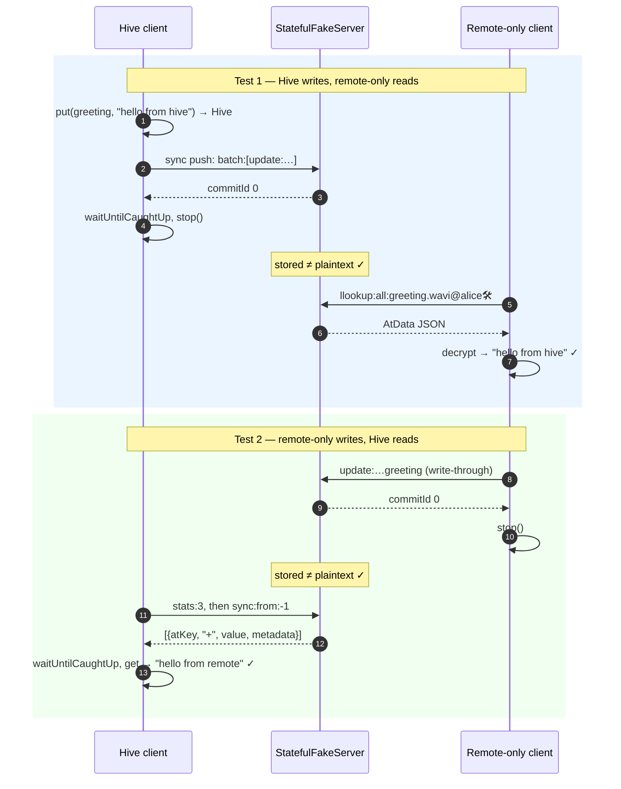

#### What X-R2 caught

- **The 6b bug.** Direction 1 crashed in `GetResponseTransformer`, as described in §4.
- **A test bug, not a product bug.** Direction 2 failed with "another storage is already open at remote:@alice🛠". The storage was missing `closedByClient: true`.

---

### Verification

| Branch | at_client suite | analyze | wasm gate |
|---|---|---|---|
| 6a | — | clean | ✓ both barrels |
| 6b | 2153 / 2153 | clean | ✓ |
| 6c | 2159 / 2159 | clean | ✓ |
| 6d | 2161 / 2161 | clean | ✓ |

- Across 6a–6d: 13 files changed, +479 / −8.
- None of the commits carries an AI attribution trailer.
- `CHANGELOG.md` (4.0.0-rc1) has three new entries: the `get` fix, the **BREAKING** `replicatesServer` member, and the sync-warning fix.

---

### Open items

| Item | Owner | Blocks |
|---|---|---|
| The 3 inherited blocked packages (`at_lookup`, `at_utils`, `chalkdart`) | PB-1 / PB-2 (#2214, #2223) | A fully io-free graph. The gate ratchets at 3 until then |
| Whether to cherry-pick the 6b `get` fix onto stage2b (#2259) | Your call. #2259 is untouched for now | Nothing. The fix reaches trunk through the stack either way |
| `update:meta:` in `StatefulFakeServer` | Whoever next needs it in a test | Nothing today. The fake throws `UnimplementedError` for it |
| X-R2 against a **real** atServer | Later, in the functional/e2e lane | Nothing for PB-3. The fake covers the client-side contract |
