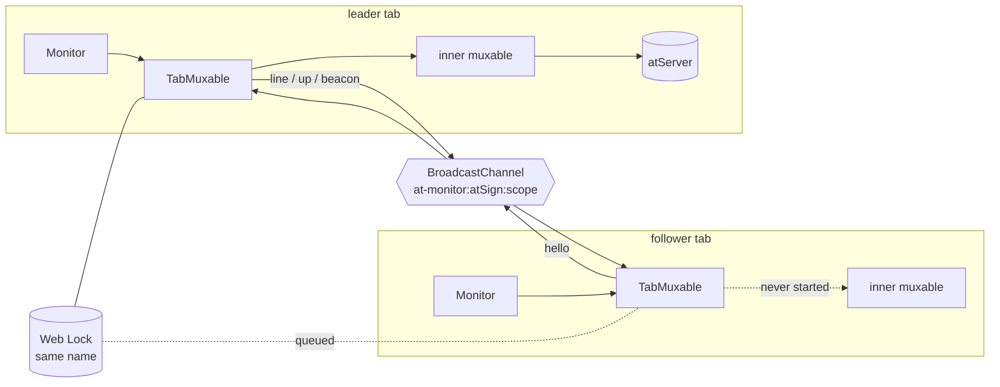

# tab-coordination.md — one monitor connection for the tabs of an origin

**Status:** built 2026-11-09, at_lookup 4.1.0. Rulings in [`decisions.md`](decisions.md) D-19 (amendments of 2026-11-02, 2026-11-05 and 2026-11-09).
**Where:** `packages/at_lookup/lib/src/shared_monitor/` (neutral), `lib/src/web/browser_shared_monitor_ports.dart` and `tabSharedLookUps` in `at_lookup_web.dart` (browser).

## Why the muxable seam

| Option | Cost |
|---|---|
| Transport-level follower | Forges the `@` prompt, PKAM, the `monitor:` ack and noop replies |
| **Muxable-level wrapper** (chosen) | `TabMuxable implements AtLookupMuxable` over the muxable the inner factory builds; `Monitor` never sends verbs, so a follower's inner never connects |

## Shape

- **Ports** (`shared_monitor_ports.dart`): `MonitorLock.request(name, {steal}) → LockRequest{granted, abort}`, `LockGrant{lost, release}`; `MonitorChannel{post, messages, close}`; `PageLifecycle.events` of `visible | pageShow | online`. Messages are one-line JSON `{"t":..,"v":..}`; unknown shapes are dropped.
- **Roles.** `startNotifications` opens the channel, posts `hello`, requests the lock. Granted → leader: start inner with the caller's watermark callback, relay `notifications` as `line` and `notificationConnectionUp` as `up`, beacon every `beaconInterval`, answer every `hello` with `up` + beacon. Queued → follower: mirror `line` to `notifications`, `up` to `notificationConnectionUp` on change only.
- **Handoff.** Leader `stopNotifications` stops inner, releases the lock; the next request in line is granted and starts its inner from its own cursor. The service above de-duplicates the atServer's inclusive re-send.
- **Frozen leader (R1).** Three missed beacons → `hello`; one more interval unanswered → `request(steal: true)`. The old grant's `lost` fires on thaw → stop inner, `up=false`, follow again.
- **Liveness.** Leader: `visible`/`pageShow` with no line for `staleAfter` → `dropConnection()` once; `online` → always. Followers: post `hello` on any page event.
- **Start failure.** A leader whose inner will not start keeps the lock and retries on 1…34 s, capped.

## Browser ports

| Port | Implementation | Note |
|---|---|---|
| Lock | `navigator.locks.request(name, {signal} \| {steal}, cb)`; held until the promise `cb` returns resolves on `release()` | `steal` and `signal` are exclusive in the spec; a stealing request is granted at once. Stolen holder's request rejects with `AbortError` → `lost` |
| Channel | `BroadcastChannel(name)`, string payloads only | Same-origin by construction |
| Lifecycle | `pageshow`, `online` on `window`; `visibilitychange` on `document`, forwarded when `visibilityState == 'visible'` | Listened to by name: package:web's `CustomEventProviders.visibilityChangeEvent` picks `webkitvisibilitychange` on any browser exposing `document.webkitHidden` (Chrome does), and that event never fires |

## Tests

| Where | What |
|---|---|
| `at_lookup/test/shared_monitor/tab_muxable_test.dart` | In-memory three-tab rig under `fake_async`: one connection, relay, late joiner, handoff, follower stop, steal on/off, liveness, start retry, codec (T2–T5, T7–T9) |
| `at_client/test/notification_handoff_test.dart` | Two `NotificationServiceImpl`s over the rig; the id relayed before the handoff and re-sent after it reaches each subscriber once (T6) |
| `at_lookup/test/web/browser_shared_monitor_ports_test.dart` | Headless Chrome: channel fan-out, lock order, abort, steal, page events (T10) |
| Catalogue | `features/at_lookup/shared_monitor.feature`, `features/at_client/notification_handoff.feature` |

## Gotchas met

- Awaiting `StreamSubscription.cancel()` on a controller without `onCancel` returns the root zone's null future; under `fakeAsync` the continuation never runs. The wrapper never awaits cancels.
- Instance-method tear-offs are `==` but never `identical`; tests compare watermark callbacks with `equals`.

## Out of scope (P3b, P5)

Disconnect-reason taxonomy and retry triggers beyond `online`; the JS facade's listener state and OS notifications, which consume this layer.
