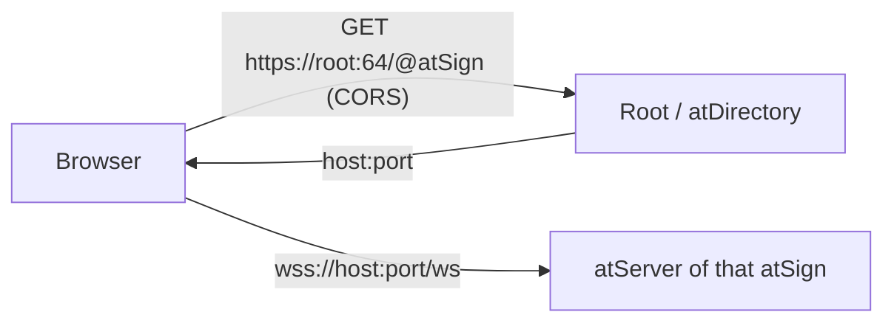

# Direct mode (`?direct=1`)

The browser reaches each atSign's own atServer over `wss://host:port/ws`, with no proxy. Proxy mode (the default) sends every connection to one proxy instead.

## Pieces
Both modes are trunk's at_lookup, chosen once by `devTransport(options)`.

| Mode | Lookup factory | Address finder |
|---|---|---|
| direct | `webSocketLookUps(directoryPort: root.rootPort)` | `HttpsSecondaryAddressFinder(root.rootDomain, port: root.rootPort)` |
| proxy | `proxyWebSocketLookUps(host, port)`: `fixedAddressWebSocketLookUps` with `proxyPreamble` (`from:<atSign>`) | `FixedSecondaryAddressFinder(proxyHost, proxyPort)` |

`DevSessionOptions.root` is an `AtRootDomain` (default `root.atsign.org:64`; `?root=host:port`). It also fills `AtClientPreference.rootDomain`/`rootPort`, so the key-copy lookup uses the same root.

## Why the peer-key lookup passes no finder
`lookup_server_copy.dart` reads a peer's published key copy. A fixed address there would send it to the user's own atServer, which answers AT0009. With no finder, the factory's default applies: the root HTTPS lookup in direct mode, the proxy in proxy mode.

## Facts checked (2026-11-02, on the pre-trunk branch)
- Production root sends `access-control-allow-origin: *` on 200 and 404.
- A production atServer upgrades `/ws` for a foreign Origin (101).

## Open
- Browser-verified once (2026-11-03, dart2js, two production atSigns): an encrypted notify from a Chrome tab reached the Dart `at_talk` CLI. That run used the at_talk demo page. `index.html?direct=1` sends the same `direct`/`root` options to `openSession` but has not been run in a browser. dart2wasm in direct mode has not been tried.
- Browser-tagged tests (`test/js`, `test/web`): 40 passed under `-p chrome` in CI (2026-11-03, #2431's `at_client_wasm_browser`).
- The VE root needs a trunk rebuild (at_server#2894) before `?root=` can target it.
