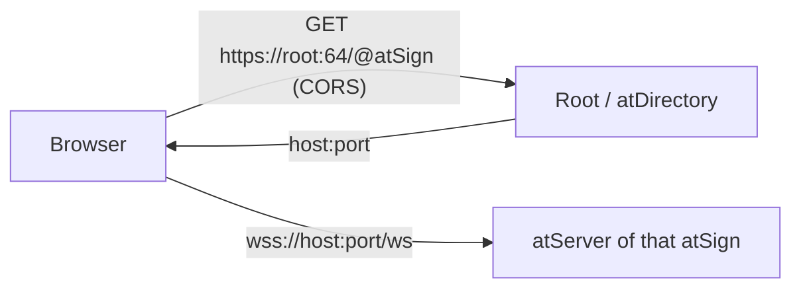

# Transport: direct (default) and the dev proxy

By default the browser reaches each atSign's own atServer over `wss://host:port/ws`, with no proxy. A dev proxy is used only when `DevSessionOptions` is given both `proxyHost` and `proxyPort`; then every connection goes to it. There is no fallback from one to the other: a failed direct connect fails the open.

## Pieces
Both modes are trunk's at_lookup, chosen once by `sessionTransport(options)`.

| Mode | Lookup factory | Address finder |
|---|---|---|
| direct (default) | `webSocketLookUps(directoryPort: root.rootPort)` | `HttpsSecondaryAddressFinder(root.rootDomain, port: root.rootPort)` |
| proxy (`proxyHost` + `proxyPort`) | `proxyWebSocketLookUps(host, port)`: `fixedAddressWebSocketLookUps` with `proxyPreamble` (`from:<atSign>`) | `FixedSecondaryAddressFinder(proxyHost, proxyPort)` |

`DevSessionOptions.root` is an `AtRootDomain` (default `root.atsign.org:64`). It also fills `AtClientPreference.rootDomain`/`rootPort`.

## What the dev proxy sees
The proxy is opt-in and for development. Use it only on a machine and network you control, never against production atSigns through a proxy you do not run.

The connection to the proxy is the whole atProtocol session, so the proxy:
- learns the atSign from the `from:<atSign>` preamble and which atServer each connection is for;
- sees every command and response on the connection: key names, metadata, the authentication exchange, notification traffic and timing;
- sees value ciphertext only: values are end-to-end encrypted by the client, and private keys never leave the page.

Direct mode has no such intermediary: the only parties on the path are the root (an HTTPS lookup of the atSign's address) and the atServer.

## Facts checked (2026-11-02, on the pre-trunk branch)
- Production root sends `access-control-allow-origin: *` on 200 and 404.
- A production atServer upgrades `/ws` for a foreign Origin (101).
