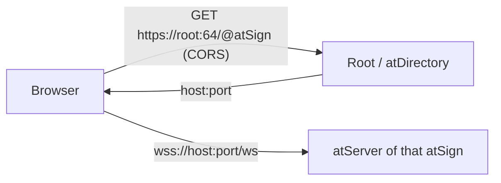

# Transport: direct (default) and the dev proxy

By default the browser reaches each Atsign's own atServer over `wss://host:port/ws`, with no proxy. A dev proxy is used only when `SessionTransportOptions` is given both `proxyHost` and `proxyPort`, or a `proxy:<host>` root; then every connection goes to it. There is no fallback from one to the other: a failed direct connect fails the open.

## Pieces
Both modes are trunk's at_lookup, chosen once by `sessionTransport(options)`.

| Mode | Lookup factory | Address finder |
|---|---|---|
| direct (default) | `webSocketLookUps(directoryPort: root.rootPort)` | `HttpsSecondaryAddressFinder(root.rootDomain, port: root.rootPort)` |
| proxy (`proxyHost` + `proxyPort`, or a `proxy:<host>` root) | `fixedAddressWebSocketLookUps(host: host, port: port)`; at_lookup sends `from:<atSign>` first on each connection, because the root is `proxy:<host>` | `FixedSecondaryAddressFinder(host, port)` |

`SessionTransportOptions.root` is an `AtRootDomain`: by default the production atDirectory, `root.atsign.org:64`, and for a proxy `proxy:<host>` at the proxy's port. `sessionTransport` passes it on as `SessionTransport.root`, and `portalSession` fills `AtClientPreference.rootDomain`/`rootPort` from it. A `prefs` that names another root is refused with an `ArgumentError` before any connection.

## What the dev proxy sees
The proxy is opt-in and for development. Use it only on a machine and network you control, never against production Atsigns through a proxy you do not run.

The connection to the proxy is the whole Atsign Protocol session, so the proxy:
- learns the Atsign, and which atServer each connection is for, from the `from:<atSign>` that at_lookup sends first on each connection;
- sees every command and response on the connection: key names, metadata, the authentication exchange, notification traffic and timing;
- resolves and answers for every Atsign the session talks to, since the single proxy stands in for each atServer: it is trusted for addressing as well as transport;
- sees value ciphertext only: values are end-to-end encrypted by the client, and private keys never leave the page.

Direct mode has no such intermediary: the only parties on the path are the root (an HTTPS lookup of the Atsign's address) and the atServer.

## Facts checked (2026-11-02, on the pre-trunk branch)
- Production root sends `access-control-allow-origin: *` on 200 and 404.
- A production atServer upgrades `/ws` for a foreign Origin (101).
